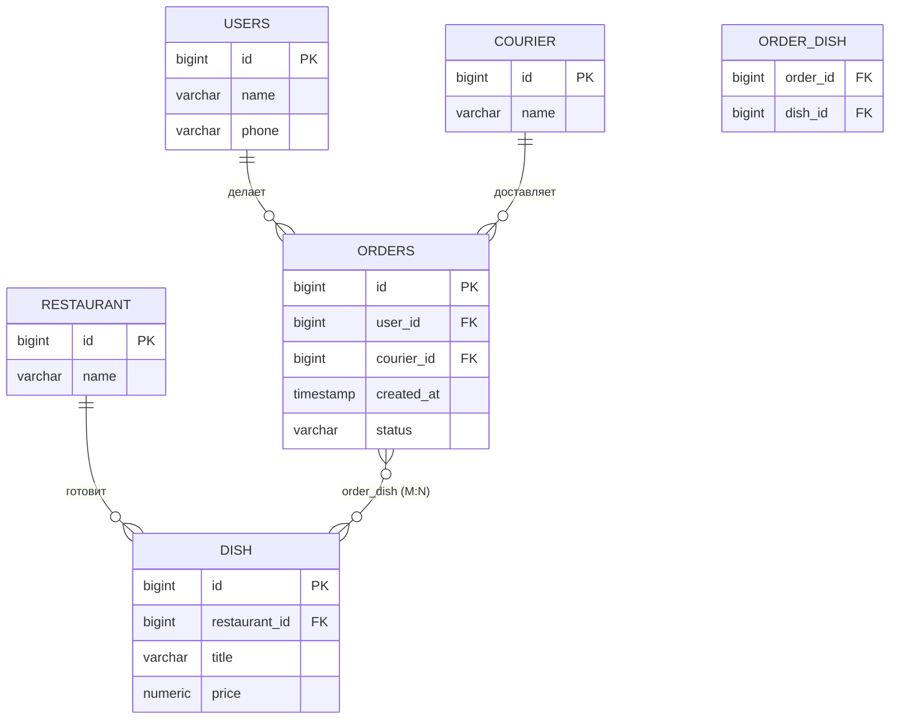

# Подготовка к рубежке: Jakarta EE / JPA / Spring / AOP

> Файл охватывает все задания с фото: **Задание 1** (вопросы 0–9), **Задание 2** (AOP: Advice, Join Point, Pointcut, Aspect) и **Задание 3** (ER-модель, JPA-сущности, архитектура и базовые компоненты веб-приложения).
> Вариант по номеру: в Задании 1 и 2 берётся пункт с номером варианта (0–9), в Задании 3 — предметная область по таблице. **Чётный вариант → Spring MVC + JPA, нечётный → Jakarta EE + JPA.**
> **В начале — справка про устройство Jakarta EE и CDI (в сравнении со Spring). В конце файла — Часть 2 (вопросы к лабораторным) и Часть 3 (сверка со слайдами лекций: Java EE, Транзакции, Persistence, Spring; в её конце — таблица исправлений) — вопросы к защите лабораторных работ №1 и №2.**
> Примечание: я не смог открыть ваш GitHub-репозиторий (сайт запрещает автоматический доступ), поэтому теория написана по стандартным спецификациям и документации.

## Оглавление

- **Справка: как устроена Jakarta EE и CDI-бины (в сравнении со Spring)**
- Задание 1
  - 0. Jakarta Data
  - 1. DAO-паттерн
  - 2. Жизненный цикл Entity в JPA
  - 3. CDI beans
  - 4. Конфликты при параллельном доступе
  - 5. Уровни изоляции транзакций
  - 6. Наследование в ORM
  - 7. Spring и ApplicationContext
  - 8. Архитектура Spring Web MVC
  - 9. Способы написания запросов в JPA
- Задание 2 — AOP
- Задание 3 — ER-модель, JPA, архитектура приложения

---

# СПРАВКА: как устроена Jakarta EE и CDI-бины (в сравнении со Spring)

## 1. Главная мысль
- **Spring**: бин по умолчанию — **singleton**. Один экземпляр на `ApplicationContext`; хочешь другое время жизни — явно ставишь `@Scope`.
- **Jakarta EE (CDI)**: бин по умолчанию — **`@Dependent`**. Это **не** singleton: каждая точка внедрения (`@Inject`) получает **свой новый экземпляр**, который живёт ровно столько, сколько объект, в который его внедрили. Время жизни выбирается **scope-аннотацией на классе**, и в Jakarta EE это — центральная идея («Contexts» в названии CDI).

Поэтому в Jakarta EE почти всегда вы осознанно пишете `@RequestScoped`, `@ApplicationScoped`, `@SessionScoped`, а не оставляете значение по умолчанию. Аналог «спринговского singleton-сервиса» здесь — `@ApplicationScoped` (или `@Stateless` EJB, или `@Singleton`).

## 2. Из чего состоит Jakarta EE
Jakarta EE — это не библиотека, а **набор спецификаций + сервер приложений** (WildFly, Payara, GlassFish, TomEE, Open Liberty), в котором есть **контейнеры**. Вы пишете классы с аннотациями, упаковываете в **WAR/EAR** и «деплоите» на сервер. **Контейнер сам создаёт ваши объекты**, внедряет зависимости, открывает транзакции, проверяет права, управляет пулами и уничтожает объекты.

```
┌────────────────────── Сервер приложений ──────────────────────┐
│  Web container: Servlet, JSP, REST (JAX-RS), Filters           │
│  EJB container: @Stateless / @Stateful / @Singleton / MDB      │
│  CDI container: все управляемые бины, scope'ы, события         │
│  Сервисы: JTA (транзакции), JPA, JMS, Security, JNDI, пул БД   │
│                                                                │
│        ваш WAR/EAR (классы с аннотациями, beans.xml, ...)      │
└────────────────────────────────────────────────────────────────┘
```
Ничего не запускается через `main()`: контейнер стартует, находит ваши классы и работает с ними сам.

## 3. Как контейнер находит бины (bean discovery)
1. При деплое контейнер сканирует архив (**bean archive**).
2. В CDI 4 (Jakarta EE 10/11) режим по умолчанию — **`annotated`**: бином считается класс, у которого есть **аннотация, определяющая scope** (`@ApplicationScoped`, `@RequestScoped`, `@Dependent`…) или аннотация-стереотип; EJB (`@Stateless` и т. п.) — бины автоматически.
3. Файл `beans.xml` (в `WEB-INF/` или `META-INF/`) — может быть пустым или задавать режим: `bean-discovery-mode="all"` (любой класс — бин, как `@Dependent`), `"annotated"`, `"none"`.
4. Подходящие типы: конкретный класс с пустым конструктором (или с `@Inject`-конструктором), не `final` для normal-scope (из-за прокси), не нестатический внутренний класс.

Аналог в Spring — `@ComponentScan` по пакетам + `@Component/@Service`. В Jakarta EE «пакетов для скана» нет: сканируется весь архив.

## 4. Внедрение зависимостей: `@Inject` и разрешение типа
`@Inject` ищет бин **по типу** (и квалификаторам). Если подходящих бинов несколько — ошибка неоднозначности (`AmbiguousResolutionException`), её решают **квалификаторами** (`@Qualifier`-аннотации; в Spring — `@Qualifier`/`@Primary`). Если не найден — `UnsatisfiedResolutionException`. Проверка выполняется **при старте приложения**, а не в рантайме.

```java
@ApplicationScoped                       // один экземпляр на приложение (аналог spring singleton)
public class OrderService {
    @Inject UserRepository users;        // внедрён CDI
    @PersistenceContext EntityManager em;// внедрён контейнером (ресурс JPA)
    @Resource DataSource ds;             // ресурс из JNDI
}
```
Способы: поле, конструктор (`@Inject` на конструкторе), метод-инициализатор. Для ресурсов контейнера (EntityManager, DataSource, EJB) — свои аннотации: `@PersistenceContext`, `@Resource`, `@EJB`.

## 5. Scope'ы и контексты — сердце CDI
**Контекст (context)** — «хранилище экземпляров» с определённым временем жизни. Бин создаётся при **первом обращении** в своём контексте и уничтожается при его завершении.

| Scope | Контекст / время жизни | Аналог в Spring |
|---|---|---|
| `@ApplicationScoped` | всё приложение, один экземпляр | `singleton` (по умолчанию) |
| `@SessionScoped` | HTTP-сессия пользователя (Serializable) | `session` |
| `@RequestScoped` | один HTTP-запрос | `request` |
| `@ConversationScoped` | диалог между запросами (begin/end) | нет прямого аналога |
| `@Dependent` (**по умолчанию**) | как у владельца-объекта; новый экземпляр на каждую точку внедрения | `prototype` (близко) |
| `@Singleton` (pseudo-scope) | один экземпляр, **без прокси** | singleton без прокси |
| `@TransactionScoped` | на время JTA-транзакции | `@Transactional`-ресурсы (аналога нет) |

Итог: «по умолчанию singleton» (Spring) ≈ «`@ApplicationScoped` указываем явно» (CDI); «по умолчанию `@Dependent`» (CDI) ≈ `prototype` (Spring).

## 5а. Нет, не всё `@ApplicationScoped`: роли классов в Jakarta EE

В Spring роль класса задаётся «стереотипом» (`@RestController`, `@Service`, `@Repository`), а время жизни — по умолчанию singleton. В Jakarta EE **единого `@Service` нет**: роль определяют **аннотации конкретной технологии**, а время жизни — **отдельная scope-аннотация** (или тип EJB). Scope выбирают под задачу, поэтому в одном приложении есть бины разных scope'ов.

| Роль в Spring | Как выглядит в Jakarta EE | Типичный scope / жизненный цикл |
|---|---|---|
| `@RestController` / `@Controller` | JAX-RS ресурс `@Path("/orders")` (REST) или `@WebServlet` (Servlet) | ресурс JAX-RS — **на запрос** (в связке с CDI фактически как `@RequestScoped`, если не указано иное); сервлет — **один экземпляр на объявление** (singleton, обслуживает потоки параллельно, поэтому без изменяемых полей!) |
| `@Service` (бизнес-логика) | `@Stateless` EJB (транзакции из коробки) **или** CDI-бин `@ApplicationScoped` + `@Transactional` | `@Stateless` — **пул** экземпляров (не singleton); `@ApplicationScoped` — один на приложение |
| `@Repository` / DAO | `@Stateless` или `@ApplicationScoped` класс с `@PersistenceContext EntityManager`; в Jakarta Data — интерфейс `@Repository` | как у сервиса |
| `@Component` (общий бин) | любой класс + scope-аннотация | на выбор |
| «данные пользователя в сессии» | `@SessionScoped` (Serializable) | сессия |
| «данные текущего запроса» | `@RequestScoped` | запрос |
| `@Configuration` + `@Bean` | класс с методами `@Produces` | на выбор |
| `@Entity` | то же `@Entity` (это не бин, а сущность JPA) | управляется persistence context |

**Правила выбора scope'а (на практике):**
- без состояния, общая логика (сервисы, репозитории, утилиты) → `@ApplicationScoped` или `@Stateless`;
- данные текущего запроса (форма, текущий пользователь запроса) → `@RequestScoped`;
- данные пользователя между запросами (корзина, вход) → `@SessionScoped`;
- нужно «каждому свой экземпляр» (вспомогательные объекты, стратегии) → `@Dependent`.

**Важно:** `@ApplicationScoped`-бин **общий для всех потоков**, поэтому в нём нельзя хранить изменяемое состояние запроса в полях (как и в singleton-сервисе Spring). Состояние запроса — в `@RequestScoped`-бинах или в параметрах методов.

**Стереотипы в CDI есть, но свои:** `@Stereotype` — вы сами объединяете в одну аннотацию набор других (например, scope + `@Named` + `@Transactional`). Встроенный пример — `@Model` = `@Named` + `@RequestScoped`. Готовых «`@Service`/`@Controller`» в спецификации нет — это отличие от Spring.

**Если класс вообще без аннотаций** (при `bean-discovery-mode="all"`) — это `@Dependent` бин; в режиме `annotated` (по умолчанию) такой класс бином не считается и внедряться не будет.

## 6. Клиентские прокси — как CDI решает проблему разных времён жизни
Если внедрить `@RequestScoped`-бин в `@ApplicationScoped`-бин, то обычная ссылка была бы «застывшей» на первый запрос. Поэтому для **normal scope** (`Application`, `Session`, `Request`, `Conversation`) контейнер внедряет не сам объект, а **клиентский прокси** (подкласс вашего класса). При каждом вызове метода прокси находит **актуальный экземпляр в текущем контексте** (для текущего запроса/сессии) и делегирует ему вызов.

```java
@RequestScoped  public class CurrentUser { String name; ... }

@ApplicationScoped
public class AuditService {
    @Inject CurrentUser user;   // это прокси; user.getName() вернёт имя пользователя ТЕКУЩЕГО запроса
}
```
Отсюда требования: класс не `final`, нет `final`-методов, есть конструктор без параметров (или `@Inject`-конструктор + proxyable-конструктор). Для `@Dependent` и `@Singleton` прокси **нет**. В Spring аналог — `@Scope(proxyMode = TARGET_CLASS)`; его нужно указывать вручную, в CDI это встроено.

## 7. Жизненный цикл бина
1. Контейнер создаёт экземпляр (конструктор).
2. Внедряет зависимости (`@Inject`, `@PersistenceContext`, …).
3. Вызывает `@PostConstruct`.
4. Бин используется (вызовы через прокси, **interceptors** — аналог AOP, события).
5. При завершении контекста (конец запроса/сессии/приложения) вызывается `@PreDestroy`, объект уничтожается.

## 8. CDI-бин и EJB — не одно и то же
- **CDI-бин** — лёгкий управляемый объект с scope'ами, DI, событиями, interceptors. Транзакций «из коробки» нет — только по `@Transactional`.
- **EJB** (`@Stateless`, `@Stateful`, `@Singleton`) — «усиленный» бин с **декларативными транзакциями по умолчанию (REQUIRED)**, **пулом экземпляров**, безопасностью, асинхронностью, таймерами. `@Stateless` — это пул одинаковых экземпляров: каждый вызов получает любой свободный (не singleton!); `@Stateful` — экземпляр на клиента; `@Singleton` (EJB) — один на приложение.
- EJB автоматически является CDI-бином, его можно внедрять через `@Inject` или `@EJB`.

Типичная раскладка слоёв в Jakarta EE:
```
Servlet / JAX-RS ресурс / CDI-бин (@RequestScoped) — представление, взаимодействие с запросом
        │ @Inject
@Stateless EJB или @ApplicationScoped + @Transactional — бизнес-логика, транзакции
        │ @PersistenceContext
EntityManager (JPA)  → PostgreSQL
```

## 9. Транзакции и JPA в контейнере
- `@PersistenceContext EntityManager em` — внедряется **прокси transaction-scoped** `EntityManager`: он потокобезопасен, привязан к текущей JTA-транзакции; вне транзакции читать можно, менять — нет.
- Транзакцию открывает контейнер при входе в метод EJB (или `@Transactional`-метод) и закрывает на выходе; коммит или откат (по исключению).
- Пул соединений и `DataSource` настраивает **сервер** (JNDI-имя, например `java:/jdbc/ShopDS`), а в `persistence.xml` на него только ссылаются.

## 10. Внедрение «нестандартных» объектов: producers
Если объект нельзя создать конструктором (внешний ресурс, настроенный объект), пишут **producer**:
```java
@ApplicationScoped
public class Producers {
    @Produces @RequestScoped
    public Locale locale(@Context HttpServletRequest req) { return req.getLocale(); }
}
```
Аналог — метод `@Bean` в `@Configuration` в Spring.

## 11. События, interceptors, decorators
- **События**: `@Inject Event<OrderPlaced> ev; ev.fire(x)` ↔ `void on(@Observes OrderPlaced x)` — типизированная связь компонентов без прямых ссылок (аналог `ApplicationEventPublisher`/`@EventListener`).
- **Interceptors**: сквозная логика (`@InterceptorBinding`, `@AroundInvoke`) — аналог Spring AOP.
- **Decorators**: расширяют бизнес-методы конкретного интерфейса.

## 12. Сводная таблица «Spring ↔ Jakarta EE»
| Что | Spring | Jakarta EE |
|---|---|---|
| Контейнер | `ApplicationContext` | сервер приложений: web/EJB/CDI-контейнеры |
| Старт | `main()` + `SpringApplication.run` (Boot, встроенный сервер) | деплой WAR/EAR на сервер |
| Поиск бинов | `@ComponentScan` (пакеты) | bean discovery по архиву + `beans.xml` |
| Пометка бина | `@Component/@Service/@Repository/@Controller` | scope-аннотация (`@ApplicationScoped`…) или `@Stateless` |
| Scope по умолчанию | **singleton** | **`@Dependent`** (новый экземпляр на точку внедрения) |
| «Singleton-сервис» | любой `@Service` | `@ApplicationScoped` / EJB `@Singleton` |
| Внедрение | `@Autowired` / конструктор | `@Inject` / `@EJB` / `@PersistenceContext` / `@Resource` |
| Уточнение типа | `@Qualifier`, `@Primary` | `@Qualifier`-аннотации, `@Alternative`, `@Named` |
| Прокси при разных scope | вручную (`proxyMode`) | автоматически (client proxy) |
| Фабрика объектов | `@Bean` | `@Produces` |
| События | `@EventListener` | `@Observes` |
| AOP | `@Aspect`, `@Around` | `@Interceptor`, `@AroundInvoke` |
| Транзакции | `@Transactional` (Spring) | EJB CMT (по умолчанию) / `@Transactional` (CDI) |
| Конфигурация БД | `application.properties` | `persistence.xml` + DataSource на сервере |
| Веб | Spring MVC (`@Controller`) | Servlet / JAX-RS (`@Path`) |

## 13. Запомнить для ответа
1. В Jakarta EE объектами управляет **контейнер**; вы описываете их аннотациями.
2. CDI = DI + **контексты (scope)** + события + interceptors; бин по умолчанию — **`@Dependent`**, а «как singleton в Spring» — **`@ApplicationScoped`**.
3. Для scope'ов с «длинным» и «коротким» временем жизни внедряются **клиентские прокси**.
4. Бизнес-логика с транзакциями — чаще **EJB** (`@Stateless`, транзакция REQUIRED из коробки) или CDI-бин с `@Transactional`.
5. `EntityManager` внедряется через `@PersistenceContext`, DataSource — на уровне сервера.
6. Spring — «фреймворк с собственным контейнером, singleton по умолчанию»; Jakarta EE — «стандарт, реализуемый сервером, scope задаётся явно».

---

# ЗАДАНИЕ 1

---

## 0. Jakarta Data, базовые принципы

### Что это
**Jakarta Data** — спецификация Jakarta EE (входит в Jakarta EE 11), которая задаёт **единый API доступа к данным на основе репозиториев**. Вы описываете *интерфейс* репозитория, а реализацию (SQL/JPQL/NoSQL-запросы) генерирует провайдер **на этапе компиляции или сборки**. Это аналог Spring Data, но стандартизированный и портируемый между реализациями (например, Hibernate Data Repositories / Hibernate Processor, Eclipse JNoSQL).

### Базовые принципы
1. **Разделение ответственности.** Предметная модель (entity) отделена от логики доступа к данным; бизнес-код работает с интерфейсом репозитория.
2. **Декларативность.** Не пишем реализацию — только интерфейс с аннотациями (`@Find`, `@Insert`, `@Query` и т. д.) или методами по соглашению об именах.
3. **Независимость от хранилища.** Один и тот же подход работает для реляционных БД (Jakarta Persistence) и NoSQL (Jakarta NoSQL). Тип хранилища определяется моделью сущности и провайдером.
4. **Проверка во время компиляции.** Провайдер (annotation processor) проверяет запросы и генерирует реализацию, ошибки видны до запуска.
5. **Интеграция с CDI.** Репозиторий — CDI-бин, внедряется через `@Inject`.
6. **Статическая метамодель.** Для безопасного обращения к атрибутам сущности генерируются классы вида `_Product` (`_Product.PRICE`, `_Product.name`).
7. **Пагинация и сортировка** — часть API (`PageRequest`, `Page`, `CursorPage`, `Sort`, `Order`, `Limit`).

### Иерархия интерфейсов репозиториев
- `DataRepository<T, K>` — маркерный корневой интерфейс (без методов).
- `BasicRepository<T, K>` — базовые операции: `save`, `saveAll`, `findById`, `findAll`, `delete`, `deleteById`, `deleteAll`.
- `CrudRepository<T, K>` — расширяет базовый: `insert`, `insertAll`, `update`, `updateAll` (для случаев, когда нужно явное различие вставки и обновления).
- Свой репозиторий можно строить и **без** наследования, просто пометив интерфейс `@Repository` и описав нужные методы.

### Аннотации
| Аннотация | Назначение |
|---|---|
| `@Repository` | пометить интерфейс как репозиторий |
| `@Find` | поиск по параметрам метода (параметры сопоставляются с атрибутами по имени или `@By`) |
| `@By("attr")` | указать атрибут, с которым сравнивается параметр |
| `@Insert`, `@Update`, `@Delete`, `@Save` | операции записи (`@Save` = вставить или обновить) |
| `@Query` | запрос на JDQL (Jakarta Data Query Language) или JPQL |
| `@Param` | именованный параметр запроса |
| `@OrderBy` | статическая сортировка |
| `@Find` + `Order<T>`/`Sort`/`PageRequest` параметры | динамическая сортировка и пагинация |

Также поддерживается **Query by Method Name**: `findByNameContainsAndPriceLessThan(...)`, `countByStatus(...)`, `deleteByExpiredTrue()`.

### Пример
```java
@Entity
public class Product {
    @Id public Long id;
    public String name;
    public BigDecimal price;
}

@Repository
public interface Products extends CrudRepository<Product, Long> {

    @Find
    List<Product> byName(String name);

    @Find
    @OrderBy("price")
    List<Product> byNameLike(@By("name") String namePattern);

    @Query("where price < :max order by price desc")
    Page<Product> cheaperThan(BigDecimal max, PageRequest page);

    List<Product> findByPriceBetween(BigDecimal from, BigDecimal to); // по имени метода

    @Delete
    void remove(Product p);
}

@ApplicationScoped
public class ShopService {
    @Inject Products products;

    public Page<Product> cheap() {
        return products.cheaperThan(BigDecimal.TEN, PageRequest.ofPage(1).size(20));
    }
}
```

### Чем отличается от DAO и JPA
- **JPA** — ORM (отображение объектов в таблицы, `EntityManager`). Jakarta Data — слой *над* ним (или над NoSQL), избавляющий от шаблонного кода DAO.
- **DAO** вручную пишет реализацию; в **Jakarta Data** реализацию генерирует провайдер.
- Относительно **Spring Data**: идея та же, но Jakarta Data стандартизирована, а запросы проверяются при компиляции.

---

## 1. DAO-паттерн (Data Access Object): описание и пример

### Описание
**DAO** — шаблон проектирования, который **инкапсулирует доступ к источнику данных** (БД, файлы, внешнее API) за интерфейсом. Бизнес-логика не знает, как именно данные хранятся (JDBC, JPA, Hibernate, NoSQL), — она работает только с DAO-интерфейсом.

### Зачем
- Отделить бизнес-логику от технологии хранения (низкая связанность).
- Возможность подменить реализацию (JDBC → JPA, тестовая in-memory реализация, mock).
- Централизовать SQL/JPQL и обработку ошибок доступа к данным.
- Упростить тестирование сервисов.

### Участники
1. **Интерфейс DAO** — контракт операций (`findById`, `save`, `delete`, `findAll`...).
2. **Реализация DAO** — конкретная технология (JDBC / JPA / Hibernate).
3. **Модель (Entity / Transfer Object)** — объект предметной области.
4. **Клиент (сервис, бизнес-объект)** — использует интерфейс DAO.
5. **Источник данных** — `DataSource`/`EntityManager`/файл.

### Схема
```
Controller -> Service -> DAO (interface) -> DaoImpl (JPA/JDBC) -> БД
                            ^ Entity / DTO
```

### Пример (JPA-реализация)
```java
public interface UserDao {
    Optional<User> findById(Long id);
    Optional<User> findByName(String name);
    List<User> findAll();
    User save(User user);
    void delete(User user);
}

@Stateless // или @Repository + @Transactional в Spring
public class UserDaoJpa implements UserDao {

    @PersistenceContext
    private EntityManager em;

    @Override
    public Optional<User> findById(Long id) {
        return Optional.ofNullable(em.find(User.class, id));
    }

    @Override
    public Optional<User> findByName(String name) {
        return em.createQuery("select u from User u where u.name = :n", User.class)
                 .setParameter("n", name)
                 .getResultStream().findFirst();
    }

    @Override
    public List<User> findAll() {
        return em.createQuery("select u from User u", User.class).getResultList();
    }

    @Override
    public User save(User user) {
        if (user.getId() == null) { em.persist(user); return user; }
        return em.merge(user);
    }

    @Override
    public void delete(User user) {
        em.remove(em.contains(user) ? user : em.merge(user));
    }
}
```

### Пример (JDBC-реализация — для сравнения)
```java
public class UserDaoJdbc implements UserDao {
    private final DataSource ds;
    public Optional<User> findById(Long id) {
        try (Connection c = ds.getConnection();
             PreparedStatement ps = c.prepareStatement("select id, name from users where id=?")) {
            ps.setLong(1, id);
            try (ResultSet rs = ps.executeQuery()) {
                return rs.next() ? Optional.of(new User(rs.getLong(1), rs.getString(2)))
                                 : Optional.empty();
            }
        } catch (SQLException e) { throw new DataAccessException(e); }
    }
    // ...
}
```

### DAO vs Repository
- **DAO** ориентирован на *таблицу/источник данных* и CRUD, «технический» слой.
- **Repository** (DDD) ориентирован на *агрегат предметной области*, выглядит как коллекция объектов. На практике (Spring Data, Jakarta Data) эти понятия сближены.

### Плюсы / минусы
- (+) слабая связанность, подменяемость, тестируемость, единое место для запросов.
- (−) дополнительный слой и шаблонный код; при использовании JPA часть функций дублирует `EntityManager` (поэтому всё чаще применяют Spring Data / Jakarta Data).

---

## 2. Жизненный цикл Entity в JPA

### Состояния сущности
1. **New (Transient)** — объект создан через `new`, не связан с persistence context, не имеет строки в БД (идентификатора, как правило, ещё нет).
2. **Managed (Persistent)** — связан с **persistence context** (контекстом персистентности), имеет идентификатор. Все изменения отслеживаются (*dirty checking*) и будут записаны в БД при `flush`/коммите.
3. **Detached** — раньше был managed, но контекст закрыт/очищен или сущность отсоединена (`detach`, `clear`, `close`, окончание транзакции в transaction-scoped контексте). Идентификатор есть, изменения не отслеживаются.
4. **Removed** — помечена на удаление (`remove`), строка будет удалена при `flush`/коммите.

### Диаграмма переходов
```
            new                 persist()               commit/flush
 (нет объекта) ──► NEW ───────────────────► MANAGED ──────────────► строка в БД
                                              │  ▲
                              remove()        │  │ merge(detached) -> возвращает managed-копию
                                              ▼  │ find()/query -> managed
                                           REMOVED   
                                              
 MANAGED ── detach()/clear()/close()/конец транзакции ──► DETACHED
 DETACHED ── merge() ──► MANAGED (копия)
 REMOVED ── persist() ──► MANAGED (отмена удаления)
```

### Операции `EntityManager`
| Метод | Что делает |
|---|---|
| `persist(e)` | NEW → MANAGED; INSERT выполнится при flush. Для REMOVED — «воскрешает». Для DETACHED — исключение |
| `merge(e)` | копирует состояние detached/new в managed-экземпляр и **возвращает управляемую копию** (исходный объект остаётся detached) |
| `remove(e)` | MANAGED → REMOVED; DELETE при flush |
| `find(Class, id)` | загружает сущность (managed) или `null`; сначала смотрит в кэш первого уровня |
| `getReference(Class, id)` | возвращает прокси без запроса (ленивая загрузка); `EntityNotFoundException`, если нет |
| `refresh(e)` | перезагружает состояние из БД, затирая изменения |
| `detach(e)` | MANAGED → DETACHED |
| `clear()` | отсоединяет все сущности контекста |
| `flush()` | синхронизирует изменения с БД (SQL выполняется, но коммита нет) |
| `contains(e)` | управляется ли сущность контекстом |
| `lock(e, mode)` | блокировка сущности |

### Persistence Context (контекст персистентности)
- Это кэш первого уровня и «единица работы»: гарантирует **один экземпляр на идентификатор** в рамках контекста (identity map).
- **Transaction-scoped** (по умолчанию в Jakarta EE/Spring): живёт, пока идёт транзакция. **Extended** — живёт дольше (в stateful-бинах, `PersistenceContextType.EXTENDED`).
- **Dirty checking:** при flush Hibernate сравнивает текущее состояние managed-сущностей со снимком загрузки и генерирует UPDATE для изменённых.
- **FlushModeType:** `AUTO` (по умолчанию: flush перед запросами, затрагивающими изменённые данные, и при коммите), `COMMIT`.

### Callback-методы жизненного цикла (listeners)
Помечаются аннотациями в сущности или в отдельном `@EntityListeners`-классе:
- `@PrePersist` / `@PostPersist` — до/после вставки
- `@PreUpdate` / `@PostUpdate` — до/после обновления
- `@PreRemove` / `@PostRemove` — до/после удаления
- `@PostLoad` — после загрузки из БД

```java
@Entity
public class Order {
    @Id @GeneratedValue private Long id;
    private Instant createdAt;
    private Instant updatedAt;

    @PrePersist void onCreate() { createdAt = updatedAt = Instant.now(); }
    @PreUpdate  void onUpdate() { updatedAt = Instant.now(); }
}
```

### Пример прохода по состояниям
```java
User u = new User("Ivan");        // NEW
em.getTransaction().begin();
em.persist(u);                    // MANAGED
u.setName("Petr");                // dirty checking -> UPDATE при commit
em.getTransaction().commit();     // INSERT + UPDATE (или один INSERT с финальным состоянием)
em.detach(u);                     // DETACHED
u.setName("Sidor");               // не отслеживается
em.getTransaction().begin();
User m = em.merge(u);             // m - MANAGED копия, u остаётся DETACHED
em.remove(m);                     // REMOVED
em.getTransaction().commit();     // DELETE
```

### Каскады и состояние
`cascade = PERSIST / MERGE / REMOVE / REFRESH / DETACH / ALL` — операции распространяются на связанные сущности; `orphanRemoval = true` удаляет «осиротевшие» дочерние объекты.

---

## 3. CDI beans: виды, примеры

### Что такое CDI
**CDI (Contexts and Dependency Injection, Jakarta CDI)** — спецификация Jakarta EE для внедрения зависимостей и управления жизненным циклом объектов с учётом **контекстов (scopes)**. Объекты, которыми управляет контейнер CDI, — **бины (beans)**.

### Что считается бином
Класс — CDI-бин, если он: конкретный (или с `@Decorator`), имеет подходящий конструктор (беспараметрический, либо с `@Inject`), не является нестатическим внутренним классом, и находится в **bean archive** (`beans.xml` или аннотация-определитель scope при `bean-discovery-mode="annotated"`; в CDI 4 по умолчанию «annotated»).

### Виды бинов
1. **Managed beans (управляемые бины)** — обычные POJO-классы с аннотацией scope.
2. **Session beans (EJB)** — `@Stateless`, `@Stateful`, `@Singleton` — тоже CDI-бины, получают транзакции, пулинг, безопасность.
3. **Message-driven beans** — не внедряются как обычные (вызываются сообщением), но управляются контейнером.
4. **Producer methods / fields** — `@Produces`: фабричные методы/поля, поставляющие объекты, которые нельзя создать конструктором (например, `EntityManager`, `Logger`, ресурсы).
5. **Synthetic beans** — бины, регистрируемые расширением (portable extension / `BeanConfigurator`).
6. **Built-in beans** — `InjectionPoint`, `Principal`, `Conversation`, `Event`, `BeanManager`, `HttpServletRequest`, `HttpSession`, `ServletContext`.
7. **Interceptors / Decorators** — также бины особого назначения.

### Области видимости (scopes)
| Scope | Время жизни | Примечание |
|---|---|---|
| `@ApplicationScoped` | всё приложение | один экземпляр, клиентский proxy |
| `@SessionScoped` | HTTP-сессия | должен быть `Serializable` |
| `@RequestScoped` | один HTTP-запрос | |
| `@ConversationScoped` | диалог (между запросом и сессией), управляется `Conversation.begin()/end()` | `Serializable` |
| `@Dependent` | **по умолчанию**; живёт столько же, сколько бин, в который внедрён | нет proxy, новый экземпляр на каждую точку внедрения |
| `@TransactionScoped` | в рамках JTA-транзакции | |
| `@Singleton` | псевдо-scope: один экземпляр, **без proxy** | |

**Client proxy:** для normal scopes (Application, Session, Request, Conversation) в точку внедрения кладётся прокси, который при каждом вызове находит экземпляр в текущем контексте (благодаря этому можно внедрять `@RequestScoped` в `@ApplicationScoped`).

### Внедрение зависимостей
```java
@ApplicationScoped
public class OrderService {

    @Inject                     // field injection
    private UserRepository users;

    private final PriceCalculator calc;

    @Inject                     // constructor injection (предпочтительно)
    public OrderService(PriceCalculator calc) { this.calc = calc; }

    @Inject                     // setter / initializer method
    void setLogger(Logger l) {...}
}
```

### Квалификаторы (разрешение неоднозначности)
```java
@Qualifier @Retention(RUNTIME) @Target({FIELD, TYPE, METHOD, PARAMETER})
public @interface Premium {}

public interface Discount { double apply(double p); }

@Premium @ApplicationScoped
public class PremiumDiscount implements Discount {...}

@ApplicationScoped
public class StandardDiscount implements Discount {...}

@Inject @Premium Discount d;   // PremiumDiscount
```
Встроенные: `@Default`, `@Any`, `@Named` (имя для EL, например в JSP), `@New` (устарел).

### Producer
```java
@ApplicationScoped
public class Resources {
    @PersistenceContext(unitName = "app")
    @Produces
    private EntityManager em;       // producer field

    @Produces @Dependent
    Logger logger(InjectionPoint ip) {
        return Logger.getLogger(ip.getMember().getDeclaringClass().getName());
    }

    public void close(@Disposes Connection c) { c.close(); }  // disposer
}
```

### Другие возможности
- **Alternatives** (`@Alternative` + `@Priority`/`beans.xml`) — подмена реализации (тесты, окружения).
- **Specializes** — один бин замещает другой.
- **Interceptors** — сквозная логика (`@InterceptorBinding`, `@AroundInvoke`) — это AOP в CDI.
- **Decorators** — расширяют поведение конкретного интерфейса.
- **События**: `@Inject Event<OrderCreated> e; e.fire(...)`, наблюдатель: `void on(@Observes OrderCreated ev)`; `fireAsync` / `@ObservesAsync`; `@Observes(during = AFTER_SUCCESS)` для транзакций.
- **Жизненный цикл**: `@PostConstruct` после внедрения, `@PreDestroy` перед уничтожением.
- **Stereotypes** — набор аннотаций под одним именем.

### Пример веб-компонента с CDI
```java
@WebServlet("/orders")
public class OrderServlet extends HttpServlet {
    @Inject OrderService service;          // CDI-внедрение в сервлет
    @Override protected void doGet(HttpServletRequest req, HttpServletResponse resp) throws IOException {
        resp.getWriter().println(service.count());
    }
}

@RequestScoped
public class RequestInfo { /* данные одного запроса */ }
```

---

## 4. Виды конфликтов при параллельном доступе к данным. Примеры

### Классификация по паре операций (конфликты транзакций)
Конфликт — когда две параллельные транзакции обращаются к одному элементу данных и хотя бы одна из операций — запись:
- **WW (write-write)** — обе пишут. Результат: *потерянное обновление*, *грязная запись*.
- **WR (write-read)** — одна пишет, другая читает неподтверждённое → *грязное чтение*.
- **RW (read-write)** — одна читает, другая затем изменяет → *неповторяющееся чтение*, *фантом*, *write skew*.
(RR конфликта не создаёт.)

### Аномалии
**1. Dirty write (грязная запись).** T2 перезаписывает данные, ещё не зафиксированные T1. Запрещено на любом уровне изоляции в современных СУБД.

**2. Dirty read (грязное чтение).** Чтение данных, изменённых другой, ещё не завершённой транзакцией (которая потом откатится).
```
T1: UPDATE acc SET bal = 0 WHERE id=1;       (не COMMIT)
T2: SELECT bal FROM acc WHERE id=1;  -> 0    (грязное значение)
T1: ROLLBACK;                                (T2 видел то, чего не было)
```

**3. Lost update (потерянное обновление).** Две транзакции читают одно значение, обе вычисляют новое и записывают — результат одной затирается.
```
Начально: stock = 10
T1: SELECT stock -> 10
T2: SELECT stock -> 10
T1: UPDATE stock = 10 - 3 = 7; COMMIT
T2: UPDATE stock = 10 - 2 = 8; COMMIT     -- потеряно списание T1; должно быть 5
```

**4. Non-repeatable read (неповторяющееся чтение).** Повторное чтение той же строки в рамках транзакции даёт другое значение, так как другая транзакция изменила/удалила её и зафиксировалась.
```
T1: SELECT price FROM item WHERE id=1;  -> 100
T2: UPDATE item SET price=120 WHERE id=1; COMMIT;
T1: SELECT price FROM item WHERE id=1;  -> 120
```

**5. Phantom read (фантомное чтение).** Повторный запрос с условием возвращает другой *набор строк*: другая транзакция добавила/удалила подходящие строки.
```
T1: SELECT count(*) FROM orders WHERE user_id=5; -> 3
T2: INSERT INTO orders(user_id,...) VALUES (5,...); COMMIT;
T1: SELECT count(*) FROM orders WHERE user_id=5; -> 4
```

**6. Write skew (асимметрия записи).** Две транзакции читают пересекающиеся данные, принимают решения на основе прочитанного и обновляют *разные* строки, нарушая общий инвариант. Классика: «в смене должен остаться хотя бы один дежурный врач» — оба уходят, считая, что второй остаётся. Возможен при snapshot-изоляции (REPEATABLE READ в PostgreSQL), устраняется только SERIALIZABLE.

**7. Deadlock (взаимная блокировка)** — T1 держит блокировку A и ждёт B, T2 держит B и ждёт A. СУБД обнаруживает цикл и откатывает одну транзакцию.

### Способы борьбы
- **Уровни изоляции** (следующий раздел).
- **Оптимистичные блокировки** (JPA `@Version`): конфликт обнаруживается при записи.
```java
@Entity class Product {
    @Id Long id;
    @Version long version;   // увеличивается при каждом UPDATE
    int stock;
}
// UPDATE product SET stock=?, version=version+1 WHERE id=? AND version=?
// если 0 строк затронуто -> OptimisticLockException (нужно повторить транзакцию)
```
- **Пессимистичные блокировки**: `SELECT ... FOR UPDATE`, JPA `LockModeType.PESSIMISTIC_WRITE`/`PESSIMISTIC_READ`/`PESSIMISTIC_FORCE_INCREMENT`, `em.lock(e, mode)`, `query.setLockMode(...)`.
- **Атомарные операции в БД**: `UPDATE item SET stock = stock - 3 WHERE id=1 AND stock >= 3`.
- **Единый порядок захвата блокировок** (против deadlock), таймауты блокировок, повтор транзакции при `serialization failure`.

Режимы JPA: `NONE`, `OPTIMISTIC` (`READ`), `OPTIMISTIC_FORCE_INCREMENT` (`WRITE`), `PESSIMISTIC_READ`, `PESSIMISTIC_WRITE`, `PESSIMISTIC_FORCE_INCREMENT`.

---

## 5. Уровни изоляции транзакций. Примеры работы

### Свойства ACID
**A**tomicity (атомарность), **C**onsistency (согласованность), **I**solation (изолированность), **D**urability (долговечность). Уровни изоляции регулируют компромисс «изоляция ↔ производительность».

### Стандарт SQL: 4 уровня
| Уровень | Dirty read | Non-repeatable read | Phantom read |
|---|---|---|---|
| READ UNCOMMITTED | возможно | возможно | возможно |
| READ COMMITTED | **нет** | возможно | возможно |
| REPEATABLE READ | нет | **нет** | возможно (по стандарту) |
| SERIALIZABLE | нет | нет | **нет** |

### Особенности PostgreSQL (реализация MVCC)
- **READ UNCOMMITTED** — по слайдам лекции «не поддерживается PostgreSQL»: уровень можно указать, но фактически работает как **READ COMMITTED** (грязное чтение невозможно никогда).
- **READ COMMITTED** (по умолчанию): каждый оператор видит снимок на момент *начала этого оператора*.
- **REPEATABLE READ**: снимок на момент начала *первого оператора транзакции* (snapshot isolation) → фантомов нет (по стандарту SQL на этом уровне они допустимы, в PostgreSQL — нет), но остаются аномалии сериализации: write skew и read-only transaction skew; при конфликте записи — ошибка `could not serialize access due to concurrent update` (SQLSTATE 40001).
- **SERIALIZABLE**: Serializable Snapshot Isolation (SSI): отслеживаются зависимости rw, при опасной структуре одна транзакция откатывается (40001) — приложение должно **повторить**.

### Как реализуется (общие подходы)
- **Блокировочный** (2PL): shared/exclusive блокировки, блокировки диапазонов (predicate/gap locks) для SERIALIZABLE.
- **MVCC**: многоверсионность, читатели не блокируют писателей.

### Примеры
**READ COMMITTED — неповторяющееся чтение возможно**
```sql
-- Сессия 1
BEGIN ISOLATION LEVEL READ COMMITTED;
SELECT balance FROM acc WHERE id = 1;   -- 100
-- Сессия 2
BEGIN; UPDATE acc SET balance = 50 WHERE id = 1; COMMIT;
-- Сессия 1
SELECT balance FROM acc WHERE id = 1;   -- 50  (изменилось!)
COMMIT;
```
**REPEATABLE READ — значение стабильно**
```sql
-- Сессия 1
BEGIN ISOLATION LEVEL REPEATABLE READ;
SELECT balance FROM acc WHERE id = 1;   -- 100
-- Сессия 2: UPDATE ...; COMMIT;
-- Сессия 1
SELECT balance FROM acc WHERE id = 1;   -- 100 (снимок)
UPDATE acc SET balance = balance - 10 WHERE id = 1;  -- ERROR 40001 (строка изменена другой транзакцией)
ROLLBACK;
```
**SERIALIZABLE — защита от write skew**
```sql
-- Две сессии, каждая: BEGIN ISOLATION LEVEL SERIALIZABLE;
-- читают количество дежурных, оба видят 2, каждая снимает с дежурства своего врача, COMMIT
-- вторая получает ERROR: could not serialize access (40001) -> повторить
```

### Установка уровня в коде
**JDBC**
```java
Connection c = ds.getConnection();
c.setAutoCommit(false);
c.setTransactionIsolation(Connection.TRANSACTION_REPEATABLE_READ);
```
**Spring**
```java
@Transactional(isolation = Isolation.REPEATABLE_READ, propagation = Propagation.REQUIRED,
               timeout = 5, rollbackFor = Exception.class)
public void transfer(...) {...}
```
**Jakarta EE (EJB/JTA)** — уровень задаётся на DataSource/через провайдер либо в соединении (`setTransactionIsolation`), Jakarta Transactions сам уровень не задаёт; `@TransactionAttribute(REQUIRED | REQUIRES_NEW | MANDATORY | SUPPORTS | NOT_SUPPORTED | NEVER)` задаёт границы транзакций.

### Propagation (распространение транзакций, Spring)
`REQUIRED` (по умолчанию), `REQUIRES_NEW`, `SUPPORTS`, `NOT_SUPPORTED`, `MANDATORY`, `NEVER`, `NESTED` (savepoint).

### Как выбирать
- Чтение отчётов — READ COMMITTED.
- Согласованное чтение нескольких запросов подряд — REPEATABLE READ.
- Критичные инварианты (деньги, бронирования) — SERIALIZABLE + retry, либо оптимистичные/пессимистичные блокировки.

---

## 6. Наследование в ORM

**Проблема:** в Java есть наследование и полиморфизм, в реляционной модели — нет. ORM предлагает стратегии отображения иерархии классов в таблицы.

### Типы
**0. `@MappedSuperclass`** — не сущность, а «шаблон» полей: поля суперкласса попадают в таблицы потомков. Нельзя делать запросы по суперклассу, не имеет собственной таблицы.
```java
@MappedSuperclass
public abstract class BaseEntity {
    @Id @GeneratedValue(strategy = GenerationType.IDENTITY) protected Long id;
    @Version protected long version;
    protected Instant createdAt;
}
@Entity public class Client extends BaseEntity { String name; }
```

**1. `SINGLE_TABLE` (одна таблица на иерархию)** — стратегия по умолчанию.
```java
@Entity
@Inheritance(strategy = InheritanceType.SINGLE_TABLE)
@DiscriminatorColumn(name = "type", discriminatorType = DiscriminatorType.STRING)
public abstract class Payment { @Id @GeneratedValue Long id; BigDecimal amount; }

@Entity @DiscriminatorValue("CARD")
public class CardPayment extends Payment { String cardNumber; }

@Entity @DiscriminatorValue("CASH")
public class CashPayment extends Payment { BigDecimal change; }
```
Одна таблица `payment(id, amount, type, card_number, change)`.
- (+) быстрые запросы, нет join'ов, простая схема, эффективный полиморфизм.
- (−) столбцы подклассов должны быть nullable; нет `NOT NULL` для специфических полей; таблица «раздувается».

**2. `JOINED` (таблица на каждый класс, join по PK)**
```java
@Entity @Inheritance(strategy = InheritanceType.JOINED)
public abstract class Person { @Id @GeneratedValue Long id; String name; }
@Entity @PrimaryKeyJoinColumn(name = "person_id")
public class Employee extends Person { BigDecimal salary; }
```
Таблицы: `person(id, name)` и `employee(person_id PK/FK, salary)`.
- (+) нормализованная схема, ограничения целостности, нет null-полей.
- (−) join'ы при запросах → медленнее, сложнее SQL.

**3. `TABLE_PER_CLASS` (таблица на конкретный класс)**
```java
@Entity @Inheritance(strategy = InheritanceType.TABLE_PER_CLASS)
public abstract class Vehicle { @Id Long id; String model; }
@Entity public class Car extends Vehicle { int doors; }
@Entity public class Truck extends Vehicle { int load; }
```
Таблицы `car(id, model, doors)` и `truck(id, model, load)`; полиморфный запрос по `Vehicle` — `UNION`.
- (+) нет null-полей и join'ов при запросах к конкретному классу.
- (−) дублирование колонок, плохая производительность полиморфных запросов, нельзя `IDENTITY`-генерацию (нужна `SEQUENCE`/`TABLE`), необязательна для провайдеров.

### Названия паттернов в лекции (Фаулер) и соответствие JPA
| Паттерн (лекция) | Стратегия JPA |
|---|---|
| **Single Table Inheritance** | `SINGLE_TABLE` |
| **Concrete Table Inheritance** | `TABLE_PER_CLASS` |
| **Class Table Inheritance** | `JOINED` |

По слайдам: *Single Table* — самое простое и производительное, но на поля подклассов нельзя наложить `NOT NULL` и таблица не нормализована; *Concrete Table* — можно накладывать ограничения на поля подклассов, но таблицы не нормализованы, плохая поддержка полиморфных запросов, низкая производительность; *Class Table* — таблицы нормализованы, можно задавать ограничения, но запросы медленнее, чем при одной таблице. (Замечание: на одном из слайдов заголовок «Concrete Table Inheritance» повторён для Class Table — это опечатка лекции.)

### Сравнение
| Критерий | SINGLE_TABLE | JOINED | TABLE_PER_CLASS |
|---|---|---|---|
| Таблиц | 1 | N | N (только конкретные) |
| Полиморфные запросы | быстро | join | UNION |
| NOT NULL для полей подкласса | нельзя | можно | можно |
| Нормализация | низкая | высокая | средняя |
| Дискриминатор | нужен | не нужен | не нужен |

### Полиморфизм в запросах
`select p from Payment p` вернёт как `CardPayment`, так и `CashPayment`. `TYPE(p) = CardPayment` — фильтр по типу в JPQL.

### Дополнительно
- **Composition vs inheritance:** `@Embeddable` / `@Embedded` — альтернатива наследованию (встраивание значения-объекта).
- Абстрактные сущности допустимы; сущность может расширять неэнтити-класс (его поля не сохраняются) и наоборот.

---

## 7. Spring и ApplicationContext, работа с бинами

### IoC и DI
**Inversion of Control** — управление созданием и связыванием объектов передаётся контейнеру. **Dependency Injection** — способ реализации: зависимости *внедряются*, а не создаются через `new`.

### Контейнер
- **`BeanFactory`** — базовый интерфейс контейнера: создание и хранение бинов, ленивая инициализация.
- **`ApplicationContext`** — расширение `BeanFactory`: плюс публикация событий (`ApplicationEvent`), интернационализация (`MessageSource`), доступ к ресурсам (`ResourceLoader`), интеграция с AOP, профили/окружение (`Environment`), автоматическая инициализация singleton-бинов при старте.
- Реализации: `ClassPathXmlApplicationContext`, `FileSystemXmlApplicationContext`, `AnnotationConfigApplicationContext`, `GenericWebApplicationContext`, `AnnotationConfigWebApplicationContext`; в Spring Boot — `AnnotationConfigServletWebServerApplicationContext`.
- В веб-приложении Spring MVC обычно **два контекста**: корневой (сервисы, репозитории, `ContextLoaderListener`) и дочерний servlet-контекст `DispatcherServlet` (контроллеры, view resolver). Дочерний видит бины родителя, но не наоборот.

### Что такое бин
Объект, созданный, настроенный и управляемый контейнером Spring. Описывается **BeanDefinition** (класс, scope, зависимости, init/destroy-методы, lazy и т. д.).

### Способы конфигурирования
1. **XML**
```xml
<bean id="userService" class="app.UserService">
    <constructor-arg ref="userRepo"/>
    <property name="mailer" ref="mailer"/>
</bean>
```
2. **Java-конфигурация**
```java
@Configuration
@ComponentScan("app")
@EnableTransactionManagement
public class AppConfig {
    @Bean
    public DataSource dataSource() {...}
    @Bean
    public PlatformTransactionManager tm(EntityManagerFactory emf) { return new JpaTransactionManager(emf); }
}
```
3. **Аннотации + component scan**: `@Component`, `@Service`, `@Repository`, `@Controller`, `@RestController`, `@Configuration`.
4. **Spring Boot**: `@SpringBootApplication` = `@Configuration` + `@EnableAutoConfiguration` + `@ComponentScan`.

### Внедрение зависимостей
- **Через конструктор** (рекомендуется): неизменяемость, обязательные зависимости, удобство тестов. С Spring 4.3 `@Autowired` на единственном конструкторе необязателен.
- **Через setter**: необязательные зависимости.
- **Через поле** `@Autowired` — просто, но хуже тестируется.
- Разрешение неоднозначности: `@Qualifier("name")`, `@Primary`, `@Resource` (по имени), `@Inject` (JSR-330).
- Значения: `@Value("${app.name}")`, `@ConfigurationProperties`.
- Коллекции: `List<Handler>` — все бины типа; `Optional`, `ObjectProvider`.

### Scope бинов
| Scope | Описание |
|---|---|
| `singleton` (по умолчанию) | один экземпляр на контейнер |
| `prototype` | новый экземпляр при каждом запросе бина |
| `request` | на HTTP-запрос (web) |
| `session` | на HTTP-сессию (web) |
| `application` | на ServletContext |
| `websocket` | на сеанс WebSocket |
Для внедрения короткоживущего бина в singleton нужен scoped proxy: `@Scope(value="request", proxyMode = ScopedProxyMode.TARGET_CLASS)`.

### Жизненный цикл бина (singleton)
1. Чтение/регистрация `BeanDefinition`; `BeanFactoryPostProcessor` (например, `PropertySourcesPlaceholderConfigurer`).
2. Создание экземпляра (конструктор / фабричный метод).
3. Внедрение зависимостей (populate properties).
4. `*Aware`-интерфейсы: `BeanNameAware`, `BeanFactoryAware`, `ApplicationContextAware`.
5. `BeanPostProcessor.postProcessBeforeInitialization`.
6. Инициализация: `@PostConstruct` → `InitializingBean.afterPropertiesSet()` → `init-method`/`@Bean(initMethod=...)`.
7. `BeanPostProcessor.postProcessAfterInitialization` (здесь создаются **AOP-прокси**).
8. Бин готов к использованию.
9. При закрытии контекста: `@PreDestroy` → `DisposableBean.destroy()` → `destroy-method`. (Для `prototype` деструкторы контейнер **не** вызывает.)

### Работа с контекстом
```java
ApplicationContext ctx = new AnnotationConfigApplicationContext(AppConfig.class);
UserService s = ctx.getBean(UserService.class);
UserService s2 = ctx.getBean("userService", UserService.class);
ctx.getBeansOfType(Handler.class);
((ConfigurableApplicationContext) ctx).close();
```

### Прочее
- **Профили**: `@Profile("dev")`, `spring.profiles.active`.
- **Условия**: `@Conditional`, `@ConditionalOnProperty` (Boot).
- **События**: `ApplicationEventPublisher.publishEvent(...)`, `@EventListener`, `ContextRefreshedEvent`.
- **Циклические зависимости**: при конструкторном внедрении — ошибка `BeanCurrentlyInCreationException`; решаются `@Lazy`, setter-внедрением или перепроектированием (в Boot 2.6+ запрещены по умолчанию).
- **Ленивая инициализация**: `@Lazy`.
- **`@DependsOn`** — явный порядок инициализации.
- **Transactions, Security, Cache, Async** реализованы через **AOP-прокси** над бинами.

---

## 8. Архитектура Spring Web MVC

### Шаблон
**MVC**: Model (данные), View (представление), Controller (обработка запросов). В Spring MVC центральный компонент — **`DispatcherServlet`** (паттерн **Front Controller**): единая точка входа для всех запросов.

### Поток обработки запроса
```
Клиент ──HTTP──► [Filters] ──► DispatcherServlet
                                   │ 1. HandlerMapping: какой handler (контроллер/метод) обработает URL?
                                   │ 2. HandlerAdapter: как вызвать этот handler
                                   │ 3. HandlerInterceptor.preHandle
                                   │ 4. Controller (метод с @RequestMapping) -> Model + имя View / ResponseBody
                                   │ 5. HandlerInterceptor.postHandle
                                   │ 6. ViewResolver: имя view -> View (JSP, Thymeleaf...)
                                   │ 7. View.render(model) -> HTML
                                   │ 8. HandlerInterceptor.afterCompletion
                                   ▼
                                Ответ клиенту
```
Для `@ResponseBody`/`@RestController` шаги 6–7 заменяются `HttpMessageConverter` (JSON/XML).

### Компоненты (стратегии DispatcherServlet)
- **HandlerMapping** (`RequestMappingHandlerMapping`) — сопоставляет запрос с методом.
- **HandlerAdapter** (`RequestMappingHandlerAdapter`) — вызывает метод, разрешает аргументы (`HandlerMethodArgumentResolver`) и обрабатывает результат (`HandlerMethodReturnValueHandler`).
- **ViewResolver** (`InternalResourceViewResolver`, `ThymeleafViewResolver`).
- **HandlerExceptionResolver** (`@ExceptionHandler`, `@ControllerAdvice`, `ResponseStatusExceptionResolver`).
- **LocaleResolver**, **ThemeResolver**, **MultipartResolver**.
- **HttpMessageConverter** — преобразование тела запроса/ответа.
- **HandlerInterceptor** — перехватчики (аналог фильтров, но на уровне Spring MVC, знают о handler).
- **Validator** / Bean Validation (`@Valid`, `BindingResult`).

### Контроллер
```java
@Controller
@RequestMapping("/orders")
public class OrderController {

    private final OrderService service;
    public OrderController(OrderService service) { this.service = service; }

    @GetMapping("/form")
    public String form() { return "orderForm"; }

    @PostMapping("/first")
    public String first(@RequestParam("name") String name, Model model) {
        model.addAttribute("order", service.firstOrder(name));
        return "orderResult";           // имя представления
    }

    @GetMapping("/{id}")
    @ResponseBody
    public OrderDto byId(@PathVariable Long id) { return service.get(id); }

    @ExceptionHandler(NotFoundException.class)
    public ResponseEntity<String> nf(NotFoundException e) {
        return ResponseEntity.status(404).body(e.getMessage());
    }
}
```
Аннотации: `@RequestMapping/@GetMapping/@PostMapping...`, `@RequestParam`, `@PathVariable`, `@RequestBody`, `@ResponseBody`, `@ModelAttribute`, `@RequestHeader`, `@CookieValue`, `@SessionAttributes`, `@RestController = @Controller + @ResponseBody`, `@ControllerAdvice`.

### Конфигурация (без Boot)
```java
public class WebInit extends AbstractAnnotationConfigDispatcherServletInitializer {
    protected Class<?>[] getRootConfigClasses()    { return new Class[]{ RootConfig.class }; }
    protected Class<?>[] getServletConfigClasses() { return new Class[]{ WebConfig.class }; }
    protected String[]   getServletMappings()      { return new String[]{ "/" }; }
}

@Configuration @EnableWebMvc @ComponentScan("app.web")
public class WebConfig implements WebMvcConfigurer {
    @Bean ViewResolver viewResolver() {
        InternalResourceViewResolver r = new InternalResourceViewResolver();
        r.setPrefix("/WEB-INF/views/"); r.setSuffix(".jsp"); return r;
    }
}
```
(В Spring Boot всё настраивается автоматически: `spring-boot-starter-web`, встроенный Tomcat, `application.properties`.)

### Слои приложения
```
View (JSP/Thymeleaf) ↔ Controller (@Controller) → Service (@Service, @Transactional) → Repository/DAO (@Repository) → JPA/Hibernate → PostgreSQL
                 ↑ DTO/Model ↑                                    ↑ Entity ↑
```

---

## 9. Способы написания запросов в JPA

1. **Поиск по первичному ключу**: `em.find(User.class, id)`, `em.getReference(...)`.

2. **JPQL (Jakarta Persistence Query Language)** — объектно-ориентированный язык запросов по *сущностям и их атрибутам*, а не таблицам.
```java
TypedQuery<Order> q = em.createQuery(
   "select o from Order o join o.user u where u.name = :name order by o.createdAt asc", Order.class);
q.setParameter("name", "Ivan");
q.setMaxResults(1);          // пагинация: setFirstResult/setMaxResults
Order first = q.getResultStream().findFirst().orElse(null);
```
Поддерживает: `join`, `left join`, `join fetch` (борьба с N+1), агрегаты (`count, sum, avg`), `group by/having`, подзапросы, `in`, `like`, `member of`, `new` (проекции в DTO: `select new app.OrderDto(o.id, o.total) from Order o`), `update`/`delete` bulk-запросы.

3. **Именованные запросы (`@NamedQuery`)** — объявляются в сущности, проверяются при старте.
```java
@Entity
@NamedQuery(name = "User.byName", query = "select u from User u where u.name = :name")
public class User {...}
// em.createNamedQuery("User.byName", User.class).setParameter("name", n).getResultList();
```

4. **Criteria API** — типобезопасное программное построение запросов (удобно для динамических фильтров), с метамоделью (`User_.name`).
```java
CriteriaBuilder cb = em.getCriteriaBuilder();
CriteriaQuery<User> cq = cb.createQuery(User.class);
Root<User> r = cq.from(User.class);
cq.select(r).where(cb.equal(r.get("name"), "Ivan"));
List<User> list = em.createQuery(cq).getResultList();
```

5. **Native SQL**: `em.createNativeQuery("select * from users where name = ?", User.class)`, `@NamedNativeQuery`, `@SqlResultSetMapping` — для специфичного SQL и оптимизаций (оконные функции, CTE).

6. **Вызов хранимых процедур**: `em.createStoredProcedureQuery("proc")`, `@NamedStoredProcedureQuery`.

7. **Entity Graph** (`@NamedEntityGraph`, `EntityGraph`) — управление тем, какие связи загружать за один запрос (fetch/load graph).

8. **Надстройки над JPA**:
   - **Spring Data JPA**: derived queries (`findFirstByUserNameOrderByCreatedAtAsc`), `@Query` (JPQL/native), `Specification`, `Pageable`, проекции.
   - **Jakarta Data** (`@Find`, `@Query`).
   - **Hibernate HQL, Criteria Hibernate, `Session`**; **QueryDSL**, **jOOQ** — сторонние DSL.

### Важное
- **Параметры** — только через `setParameter` (защита от SQL-инъекций), не склеивать строки.
- **N+1**: список из N сущностей + по запросу на каждую ленивую связь → решается `join fetch`, `EntityGraph`, `@BatchSize`.
- **Ленивая/жадная загрузка**: `FetchType.LAZY` (по умолчанию для `@OneToMany`, `@ManyToMany`), `EAGER` (по умолчанию для `@ManyToOne`, `@OneToOne`).
- Результат: `getResultList()`, `getSingleResult()` (исключения `NoResultException`/`NonUniqueResultException`), `getResultStream()`.
- Блокировка в запросе: `setLockMode(...)`; хинты: `setHint("jakarta.persistence.cache.retrieveMode", ...)`.
- Namespace: с Jakarta EE 9+ пакет **`jakarta.persistence.*`** (раньше `javax.persistence.*`).


---

# ЗАДАНИЕ 2 — AOP (Aspect-Oriented Programming)

## Общая идея
**AOP (аспектно-ориентированное программирование)** — парадигма, позволяющая выносить **сквозную функциональность** (cross-cutting concerns: логирование, транзакции, безопасность, кэширование, аудит, замер времени, обработка ошибок) из бизнес-кода в отдельные модули — **аспекты**, — не дублируя её по всей программе.

**Spring AOP** реализуется через **прокси** (JDK dynamic proxy для интерфейсов, CGLIB для классов) во время выполнения (runtime weaving) и поддерживает только перехват **вызовов методов Spring-бинов**. Для полноценного AOP (поля, конструкторы, любые объекты) используется **AspectJ** (compile-time / load-time weaving).

Включение: `@EnableAspectJAutoProxy` (в Spring Boot — `spring-boot-starter-aop`, включено автоматически).

Связь терминов:
```
Aspect = Pointcut(где) + Advice(что/когда делать)
Join Point — все возможные точки; Pointcut — выбранное подмножество
```

---

## 0. Advice (совет)

### Определение
**Advice** — это **действие, выполняемое аспектом в определённой точке соединения (join point)**; код, который «навешивается» на выбранные методы, и указание *когда* он выполняется (до, после, вокруг). Advice связан с pointcut-выражением, определяющим, где его применять.

### Типы advice (в Spring AOP)
| Тип | Аннотация | Когда выполняется |
|---|---|---|
| Before | `@Before` | перед вызовом метода |
| After returning | `@AfterReturning` | после успешного завершения (можно получить результат `returning="r"`) |
| After throwing | `@AfterThrowing` | если метод бросил исключение (`throwing="ex"`) |
| After (finally) | `@After` | после метода в любом случае (как `finally`) |
| Around | `@Around` | «оборачивает» вызов: сам вызывает `proceed()`, может изменить аргументы/результат или не вызывать метод вовсе |

Around — самый мощный; принимает `ProceedingJoinPoint`.

### Пример
```java
@Aspect
@Component
public class LoggingAspect {

    @Before("execution(* app.service.*.*(..))")
    public void before(JoinPoint jp) {
        System.out.println("Вызов: " + jp.getSignature().getName()
                           + " args=" + Arrays.toString(jp.getArgs()));
    }

    @AfterReturning(pointcut = "execution(* app.service.*.*(..))", returning = "result")
    public void afterReturn(Object result) { System.out.println("Результат: " + result); }

    @AfterThrowing(pointcut = "execution(* app.service.*.*(..))", throwing = "ex")
    public void afterThrow(Exception ex) { System.out.println("Ошибка: " + ex.getMessage()); }

    @Around("execution(* app.service.*.*(..))")
    public Object time(ProceedingJoinPoint pjp) throws Throwable {
        long t = System.nanoTime();
        try {
            return pjp.proceed();                 // вызов целевого метода
        } finally {
            System.out.println(pjp.getSignature() + " took " + (System.nanoTime() - t) + " ns");
        }
    }
}
```

---

## 1. Join Point (точка соединения)

### Определение
**Join Point** — **точка в ходе выполнения программы, в которую может быть встроен advice**. Это «место, где можно что-то перехватить»: вызов метода, выполнение метода, создание объекта, обращение к полю, обработка исключения.

- В **AspectJ** join point'ов много: вызов/выполнение метода, конструктора, чтение/запись поля, инициализация класса, обработчик исключения.
- В **Spring AOP** join point — **всегда выполнение метода** (бина, обёрнутого в прокси).

В коде join point представлен объектом:
- `JoinPoint` (для Before/After/AfterReturning/AfterThrowing): `getArgs()`, `getSignature()`, `getTarget()` (целевой объект), `getThis()` (прокси).
- `ProceedingJoinPoint` (для Around): дополнительно `proceed()` / `proceed(Object[] args)`.

### Пример
```java
@Before("execution(* app.service.OrderService.create(..))")
public void log(JoinPoint jp) {
    String method = jp.getSignature().toShortString();   // OrderService.create(..)
    Object[] args = jp.getArgs();                         // аргументы вызова
    Object target = jp.getTarget();                       // сам OrderService
}
```
Каждый вызов `orderService.create(...)` — это join point; pointcut выберет, какие из join point'ов нас интересуют.

---

## 2. Pointcut (срез)

### Определение
**Pointcut** — **предикат/выражение, выбирающее набор join point'ов**, к которым применяется advice. Отвечает на вопрос «**где** применять». Pointcut — это шаблон поиска, join point — конкретное место, которое подошло.

### Синтаксис (AspectJ pointcut expression)
Главный дизайнатор — `execution`:
```
execution(модификаторы? ТипРезультата ТипОбъявления?имяМетода(параметры) throws?)
```
Примеры:
```java
execution(public * *(..))                              // любой public метод
execution(* app.service.*.*(..))                       // любые методы всех классов пакета service
execution(* app.service..*.*(..))                      // включая подпакеты
execution(* app.service.OrderService.create(String, ..))
execution(* *..*Service.save*(..))                     // методы save* в классах *Service
```
Другие designator'ы:
| Designator | Значение |
|---|---|
| `within(app.service.*)` | выполнение в типах/пакете |
| `this(Type)` / `target(Type)` | прокси / целевой объект имеет тип |
| `args(String, ..)` | типы аргументов (позволяет захватить параметры) |
| `@annotation(Loggable)` | метод помечен аннотацией |
| `@within(Service)` | класс помечен аннотацией |
| `@target`, `@args` | по аннотациям цели / аргументов |
| `bean(*Service)` | по имени бина (Spring) |

Комбинирование: `&&`, `||`, `!`.

### Именованный pointcut
```java
@Aspect @Component
public class Pointcuts {
    @Pointcut("execution(* app.service.*.*(..))")
    public void serviceLayer() {}

    @Pointcut("@annotation(app.aop.Audited)")
    public void audited() {}

    @Pointcut("serviceLayer() && audited()")
    public void auditedService() {}
}

@Before("app.aop.Pointcuts.auditedService()")
public void audit(JoinPoint jp) {...}
```
Кастомная аннотация:
```java
@Retention(RUNTIME) @Target(METHOD) public @interface Audited {}

@Around("@annotation(audited)")                // audited — параметр метода
public Object a(ProceedingJoinPoint p, Audited audited) throws Throwable {...}
```

---

## 3. Aspect (аспект)

### Определение
**Aspect** — **модуль, объединяющий сквозную функциональность**: набор pointcut'ов и advice'ов (плюс при необходимости introduction/поля). Это аналог класса для сквозной логики: «что (advice) и где (pointcut)». В Spring — класс с `@Aspect`, зарегистрированный как бин (`@Component`).

### Другие термины AOP (для полноты)
- **Target object** — объект, на который применяются аспекты (бизнес-бин).
- **AOP proxy** — объект-обёртка, создаваемый фреймворком (JDK proxy / CGLIB).
- **Weaving (связывание)** — процесс встраивания аспектов в код: compile-time, load-time, runtime (Spring AOP — runtime).
- **Introduction** — добавление целевому классу новых интерфейсов/методов (`@DeclareParents`).

### Полный пример — аспект аудита и транзакционного тайминга
```java
@Aspect
@Component
@Order(1)                                      // порядок при нескольких аспектах
public class AuditAspect {

    private static final Logger log = LoggerFactory.getLogger(AuditAspect.class);

    @Pointcut("within(app.service..*) && @annotation(app.aop.Audited)")
    void auditedMethods() {}

    @Around("auditedMethods()")
    public Object audit(ProceedingJoinPoint pjp) throws Throwable {
        String user = SecurityContextHolder.getContext().getAuthentication().getName();
        log.info("[{}] start {}", user, pjp.getSignature().toShortString());
        long t0 = System.currentTimeMillis();
        try {
            Object res = pjp.proceed();
            log.info("[{}] ok {} in {} ms", user, pjp.getSignature().getName(),
                     System.currentTimeMillis() - t0);
            return res;
        } catch (Throwable ex) {
            log.error("[{}] fail {}: {}", user, pjp.getSignature().getName(), ex.toString());
            throw ex;
        }
    }
}

@Service
public class OrderService {
    @Audited
    public Order create(String user, List<Long> dishIds) {...}
}
```

### Где AOP в самом Spring и Jakarta EE
- Spring: `@Transactional`, `@Cacheable`, `@Async`, `@PreAuthorize`, `@Retryable` — всё работает через аспекты/прокси.
- Jakarta EE: **Interceptors** (`@Interceptor`, `@AroundInvoke`, `@InterceptorBinding`) — аналог around advice.

### Ограничения Spring AOP
- Только методы Spring-бинов; **self-invocation** (вызов `this.method()` внутри того же класса) аспект **не** срабатывает, так как идёт мимо прокси.
- `final`-классы/методы не проксируются CGLIB; `private`-методы не перехватываются.

### Краткая шпаргалка-таблица
| Термин | Отвечает на вопрос | Пример |
|---|---|---|
| Aspect | «модуль» сквозной логики | класс `LoggingAspect` с `@Aspect` |
| Join point | «где вообще можно вмешаться» | любой вызов метода бина |
| Pointcut | «где именно вмешаемся» | `execution(* app.service.*.*(..))` |
| Advice | «что и когда сделаем» | `@Before` логирование |
| Weaving | «как это встраивается» | runtime-прокси в Spring |

---

# ЗАДАНИЕ 3 — ER-модель, JPA-сущности, архитектура приложения

## Что требуется (разбор условия)

> **Заметка по прошлым годам:** в заданиях прошлых лет требовалось получить **последний** заказ пользователя (и в одном из потоков — создать пользователя, если его нет), а в нынешних слайдах — **первый** заказ плюс сохранение отсутствующего пользователя. Логика одна и та же: меняется только сортировка (`createdAt asc` для первого, `createdAt desc` для последнего; в Spring Data — `findFirstBy...OrderByCreatedAtAsc` / `findFirstBy...OrderByCreatedAtDesc`). Jakarta Faces (JSF) в файле не используется — для нечётного варианта взяты Servlet + JSP.

**3.1** На основании предметной области из своего варианта продумать **ER-модель** (минимум **4 сущности**) для **системы осуществления заказов**.
- Обязательно есть сущность **«Пользователь»** (в варианте 9 — **«Участник»**), у неё есть связи с другими сущностями.
- В ER-модели должна быть связь **«многие-ко-многим»**.
- Указать **названия сущностей** (из ER-модели) и **между какими сущностями** связь многие-ко-многим.
- **Написать код JPA-классов-сущностей**, отображающих таблицы БД (ER-модель реализована в **PostgreSQL**).

**3.2** Представить **структуру приложения (архитектуру)** и реализовать **базовые компоненты** веб-приложения для получения информации о **первом заказе, который сделал заданный пользователь**. Интерфейс отображения придумать самостоятельно. Данные хранятся в БД (используются JPA-сущности из 3.1). **Если пользователя нет — его нужно сохранить в БД.** Использовать **JPA и Spring MVC (вариант чётный)** / **JPA и Jakarta EE (вариант нечётный)**.

Интерфейс ввода: поле **«Имя»** и кнопка **Submit**.

### Алгоритм решения (чек-лист)
1. Определить предметную область по номеру варианта (таблица ниже).
2. Нарисовать ER-диаграмму: `User` (Пользователь/Участник), `Order` (Заказ), плюс ≥2 других сущностей; связи 1:N и M:N.
3. Указать M:N (через промежуточную таблицу) — какая пара сущностей.
4. Написать JPA-классы.
5. Нарисовать схему архитектуры (слои, стек).
6. Реализовать: форма → контроллер → сервис → репозиторий → БД; логика «найти пользователя по имени; если нет — создать; вернуть первый заказ (по дате/id)»; страница результата.

---

## Варианты предметных областей (рекомендуемая ER-модель)

Сущность «Пользователь» (`User`) везде связана 1:N с `Order`. Ниже — предлагаемые наборы и пара M:N.

| № | Предметная область | Сущности (≥4) | Связь «многие-ко-многим» |
|---|---|---|---|
| 0 | Кинотеатр | User, Order (билетный заказ), Ticket, Session (сеанс), Movie, Hall | **Session ↔ Movie**? Лучше: **Order ↔ Ticket** не M:N; предлагаем **Movie ↔ Genre** (если добавить Genre) или **Order ↔ Session** через `order_session`. Для простоты: **Order ↔ Session** (в одном заказе билеты на несколько сеансов, на сеанс — много заказов) |
| 1 | Сервис по доставке еды | User, Order, Dish, Restaurant, Courier | **Order ↔ Dish** (`order_dish`, с количеством — через `OrderItem`) |
| 2 | Онлайн-кинотеатр | User, Order (покупка/аренда), Movie, Subscription, Genre | **Order ↔ Movie**, а также **Movie ↔ Genre** |
| 3 | Магазин сантехники | User, Order, Product, Category, Supplier | **Order ↔ Product** |
| 4 | Грузовые перевозки | User (клиент), Order (заявка), Cargo, Vehicle, Driver | **Order ↔ Cargo** или **Vehicle ↔ Driver** |
| 5 | Парикмахерская | User (клиент), Order (запись), Service (услуга), Master, Salon | **Order ↔ Service**, **Master ↔ Service** |
| 6 | Ателье по пошиву одежды | User, Order, Garment (изделие), Fabric (ткань), Tailor | **Order ↔ Garment**, **Garment ↔ Fabric** |
| 7 | Зоомагазин | User, Order, Product, Animal (питомцы), Category | **Order ↔ Product** |
| 8 | Магазин спортивных товаров | User, Order, Product, Brand, Category | **Order ↔ Product** |
| 9 | Организация спортивного турнира | **Participant (Участник)**, Order (заявка/заказ), Tournament, Team, Discipline/Match | **Participant ↔ Tournament** (и/или **Order ↔ Discipline**) |

> Для зачёта достаточно выбрать **одну** M:N связь и чётко указать «между какими сущностями». Лучшая практика: **не использовать «голый» `@ManyToMany`, если у связи есть атрибуты** (количество, цена), а ввести промежуточную сущность (`OrderItem`) и две связи `@ManyToOne` / `@OneToMany`. Но по условию нужно показать именно M:N — используем `@ManyToMany` + `@JoinTable` (и можно упомянуть вариант с `OrderItem`).

---

## 3.1 Пример полной модели (вариант 1: «Сервис по доставке еды»)

### ER-диаграмма


Сущности: **User, Order, Dish, Restaurant, Courier**.
Связи: `User 1—N Order`, `Courier 1—N Order`, `Restaurant 1—N Dish`, **`Order M—N Dish`** (таблица `order_dish`).

### SQL (PostgreSQL)
```sql
CREATE TABLE users (
    id    BIGSERIAL PRIMARY KEY,
    name  VARCHAR(100) NOT NULL UNIQUE,
    phone VARCHAR(30)
);
CREATE TABLE restaurant (id BIGSERIAL PRIMARY KEY, name VARCHAR(100) NOT NULL);
CREATE TABLE courier    (id BIGSERIAL PRIMARY KEY, name VARCHAR(100) NOT NULL);
CREATE TABLE dish (
    id            BIGSERIAL PRIMARY KEY,
    restaurant_id BIGINT NOT NULL REFERENCES restaurant(id),
    title         VARCHAR(150) NOT NULL,
    price         NUMERIC(10,2) NOT NULL
);
CREATE TABLE orders (
    id         BIGSERIAL PRIMARY KEY,
    user_id    BIGINT NOT NULL REFERENCES users(id),
    courier_id BIGINT REFERENCES courier(id),
    created_at TIMESTAMP NOT NULL DEFAULT now(),
    status     VARCHAR(30) NOT NULL
);
CREATE TABLE order_dish (
    order_id BIGINT NOT NULL REFERENCES orders(id) ON DELETE CASCADE,
    dish_id  BIGINT NOT NULL REFERENCES dish(id),
    PRIMARY KEY (order_id, dish_id)
);
```
(Слово `order` зарезервировано в SQL — поэтому таблица называется `orders`, а `user` тоже зарезервировано в PostgreSQL — `users`.)

### JPA-сущности
```java
// ---------- User ----------
@Entity
@Table(name = "users")
public class User {
    @Id
    @GeneratedValue(strategy = GenerationType.IDENTITY)
    private Long id;

    @Column(nullable = false, unique = true, length = 100)
    private String name;

    @Column(length = 30)
    private String phone;

    @OneToMany(mappedBy = "user", cascade = CascadeType.ALL, orphanRemoval = true)
    @OrderBy("createdAt ASC")
    private List<Order> orders = new ArrayList<>();

    protected User() {}                       // конструктор по умолчанию обязателен для JPA
    public User(String name) { this.name = name; }

    public void addOrder(Order o) { orders.add(o); o.setUser(this); }   // синхронизация обеих сторон

    // getters / setters, equals/hashCode по бизнес-ключу (name) или id
}

// ---------- Order ----------
@Entity
@Table(name = "orders")
public class Order {
    @Id
    @GeneratedValue(strategy = GenerationType.IDENTITY)
    private Long id;

    @ManyToOne(fetch = FetchType.LAZY, optional = false)
    @JoinColumn(name = "user_id", nullable = false)
    private User user;

    @ManyToOne(fetch = FetchType.LAZY)
    @JoinColumn(name = "courier_id")
    private Courier courier;

    @Column(name = "created_at", nullable = false)
    private LocalDateTime createdAt = LocalDateTime.now();

    @Enumerated(EnumType.STRING)
    @Column(nullable = false, length = 30)
    private OrderStatus status = OrderStatus.NEW;

    // M:N — владеющая сторона
    @ManyToMany
    @JoinTable(name = "order_dish",
               joinColumns = @JoinColumn(name = "order_id"),
               inverseJoinColumns = @JoinColumn(name = "dish_id"))
    private Set<Dish> dishes = new HashSet<>();

    // getters / setters
}

public enum OrderStatus { NEW, COOKING, DELIVERING, DONE, CANCELLED }

// ---------- Dish ----------
@Entity
public class Dish {
    @Id @GeneratedValue(strategy = GenerationType.IDENTITY)
    private Long id;

    @Column(nullable = false, length = 150)
    private String title;

    @Column(nullable = false, precision = 10, scale = 2)
    private BigDecimal price;

    @ManyToOne(fetch = FetchType.LAZY, optional = false)
    @JoinColumn(name = "restaurant_id")
    private Restaurant restaurant;

    // обратная сторона M:N
    @ManyToMany(mappedBy = "dishes")
    private Set<Order> orders = new HashSet<>();
    // getters / setters
}

// ---------- Restaurant ----------
@Entity
public class Restaurant {
    @Id @GeneratedValue(strategy = GenerationType.IDENTITY) private Long id;
    @Column(nullable = false) private String name;
    @OneToMany(mappedBy = "restaurant") private List<Dish> dishes = new ArrayList<>();
}

// ---------- Courier ----------
@Entity
public class Courier {
    @Id @GeneratedValue(strategy = GenerationType.IDENTITY) private Long id;
    @Column(nullable = false) private String name;
    @OneToMany(mappedBy = "courier") private List<Order> orders = new ArrayList<>();
}
```

### Пояснения, которые стоит проговорить на защите
- **`mappedBy`** — указывает на *обратную* сторону связи; владеющая сторона (с `@JoinColumn`/`@JoinTable`) отвечает за внешний ключ.
- **`@ManyToMany` + `@JoinTable`** — создаёт промежуточную таблицу из двух FK; лучше использовать `Set`, а не `List` (иначе Hibernate при изменении пересоздаёт всю коллекцию).
- **Вариант с атрибутами связи:** если нужны `quantity`/`price` — вводится сущность `OrderItem` (`@ManyToOne Order`, `@ManyToOne Dish`, `int quantity`), а M:N превращается в две 1:N.
- **LAZY** для `@ManyToOne` — явный выбор (по умолчанию EAGER).
- **Первый заказ** — заказ с минимальным `createdAt` (или минимальным `id`).
- Для PostgreSQL в `persistence.xml`/`application.properties`: драйвер `org.postgresql.Driver`, диалект `PostgreSQLDialect`.

### Краткие наборы сущностей для остальных вариантов (код пишется аналогично)
- **Кинотеатр (0):** `User`, `Order`, `Session(сеанс)`, `Movie`, `Hall`. M:N — `Order ↔ Session` (`order_session`); `Movie 1—N Session`, `Hall 1—N Session`.
- **Онлайн-кинотеатр (2):** `User`, `Order`, `Movie`, `Genre`. M:N — `Order ↔ Movie`, `Movie ↔ Genre`.
- **Сантехника (3), Зоомагазин (7), Спорттовары (8):** `User`, `Order`, `Product`, `Category`/`Brand`. M:N — `Order ↔ Product`; `Category 1—N Product`.
- **Грузовые перевозки (4):** `User`, `Order`, `Cargo`, `Vehicle`, `Driver`. M:N — `Order ↔ Cargo`; `Vehicle ↔ Driver`.
- **Парикмахерская (5):** `User`, `Order`(запись), `Service`, `Master`. M:N — `Order ↔ Service`, `Master ↔ Service`.
- **Ателье (6):** `User`, `Order`, `Garment`, `Fabric`, `Tailor`. M:N — `Order ↔ Garment`, `Garment ↔ Fabric`.
- **Спортивный турнир (9):** `Participant`, `Order`(заявка), `Tournament`, `Team`, `Discipline`. M:N — `Participant ↔ Tournament` (`participant_tournament`), `Team 1—N Participant`.

---

## 3.2 Архитектура и базовые компоненты

### Требуемый UI
Страница с формой: поле **«Имя»** + кнопка **Submit**. После отправки — страница с информацией о первом заказе пользователя.

### Логика (общая для обоих стеков)
```
1. Получить name из формы.
2. Найти User по name.
3. Если не найден -> создать User(name), сохранить в БД; сообщить «пользователь создан, заказов нет».
4. Если найден -> найти первый заказ (min createdAt / min id).
5. Отобразить заказ (id, дата, статус, блюда) или «заказов нет».
```

---

### Вариант А (чётный): Spring MVC + JPA

#### Архитектура
```
Браузер ──► DispatcherServlet ──► OrderController (@Controller)
                                       │
                                       ▼
                               OrderService (@Service, @Transactional)
                                       │
                                       ▼
                    UserRepository / OrderRepository (@Repository, EntityManager)
                                       │ JPA / Hibernate
                                       ▼
                                  PostgreSQL
Представление: JSP / Thymeleaf (orderForm, orderResult)
Конфигурация: Root (DataSource, EntityManagerFactory, TransactionManager) + Web (MVC, ViewResolver)
```
Слои: **Web** → **Service** → **Repository** → **Entity/DB**.

#### Структура проекта
```
src/main/java/app
  ├─ config/    RootConfig.java, WebConfig.java, WebInit.java
  ├─ entity/    User.java, Order.java, Dish.java ...
  ├─ repository/UserRepository.java, OrderRepository.java
  ├─ service/   OrderService.java
  └─ web/       OrderController.java
src/main/resources/application.properties (или persistence.xml)
src/main/webapp/WEB-INF/views/ orderForm.jsp, orderResult.jsp
```

#### Вариант с Spring Boot + Spring Data JPA (самый короткий)
```java
// build: spring-boot-starter-web, spring-boot-starter-data-jpa, spring-boot-starter-thymeleaf, postgresql
@SpringBootApplication
public class App { public static void main(String[] a) { SpringApplication.run(App.class, a); } }

public interface UserRepository extends JpaRepository<User, Long> {
    Optional<User> findByName(String name);
}

public interface OrderRepository extends JpaRepository<Order, Long> {
    Optional<Order> findFirstByUserNameOrderByCreatedAtAsc(String name);   // первый заказ пользователя
}

@Service
public class OrderService {
    private final UserRepository users;
    private final OrderRepository orders;
    public OrderService(UserRepository users, OrderRepository orders) {...}

    @Transactional
    public Result firstOrder(String name) {
        Optional<User> user = users.findByName(name);
        if (user.isEmpty()) {
            users.save(new User(name));
            return Result.userCreated(name);
        }
        return orders.findFirstByUserNameOrderByCreatedAtAsc(name)
                     .map(Result::found)
                     .orElseGet(() -> Result.noOrders(name));
    }
}

@Controller
public class OrderController {
    private final OrderService service;
    public OrderController(OrderService s) { this.service = s; }

    @GetMapping("/")
    public String form() { return "orderForm"; }

    @PostMapping("/first-order")
    public String first(@RequestParam("name") String name, Model model) {
        model.addAttribute("result", service.firstOrder(name.trim()));
        return "orderResult";
    }
}
```
`application.properties`:
```properties
spring.datasource.url=jdbc:postgresql://localhost:5432/shop
spring.datasource.username=postgres
spring.datasource.password=secret
spring.jpa.hibernate.ddl-auto=validate
spring.jpa.properties.hibernate.dialect=org.hibernate.dialect.PostgreSQLDialect
```
`orderForm.html` (Thymeleaf):
```html
<form method="post" th:action="@{/first-order}">
    <label>Имя: <input type="text" name="name" required></label>
    <button type="submit">Submit</button>
</form>
```
`orderResult.html`:
```html
<div th:if="${result.created}">Пользователь <b th:text="${result.name}"></b> создан. Заказов пока нет.</div>
<div th:if="${result.order != null}">
    <h3>Первый заказ пользователя <span th:text="${result.name}"></span></h3>
    <p>№ <span th:text="${result.order.id}"></span>, дата <span th:text="${result.order.createdAt}"></span>,
       статус <span th:text="${result.order.status}"></span></p>
    <ul><li th:each="d : ${result.order.dishes}" th:text="${d.title} + ' — ' + ${d.price}"></li></ul>
</div>
<div th:if="${result.noOrders}">У пользователя нет заказов.</div>
<a th:href="@{/}">Назад</a>
```

#### Вариант без Boot (классический Spring MVC + «чистый» JPA)
```java
@Repository
public class UserRepository {
    @PersistenceContext private EntityManager em;

    public Optional<User> findByName(String name) {
        return em.createQuery("select u from User u where u.name = :n", User.class)
                 .setParameter("n", name).getResultStream().findFirst();
    }
    public void save(User u) { em.persist(u); }
}

@Repository
public class OrderRepository {
    @PersistenceContext private EntityManager em;

    public Optional<Order> findFirstByUser(User user) {
        return em.createQuery(
                "select o from Order o left join fetch o.dishes " +
                "where o.user = :u order by o.createdAt asc", Order.class)
            .setParameter("u", user).setMaxResults(1)    // осторожно: join fetch коллекции + setMaxResults -> пагинация в памяти
            .getResultStream().findFirst();
    }
}
```
(Лучше выбрать первый заказ без `fetch join`, а коллекцию подгружать внутри транзакции или отдельным запросом/`@EntityGraph`.)

```java
@Configuration
@EnableTransactionManagement
@ComponentScan({"app.service", "app.repository"})
public class RootConfig {
    @Bean DataSource dataSource() {
        var ds = new DriverManagerDataSource();
        ds.setDriverClassName("org.postgresql.Driver");
        ds.setUrl("jdbc:postgresql://localhost:5432/shop");
        ds.setUsername("postgres"); ds.setPassword("secret");
        return ds;
    }
    @Bean LocalContainerEntityManagerFactoryBean entityManagerFactory(DataSource ds) {
        var emf = new LocalContainerEntityManagerFactoryBean();
        emf.setDataSource(ds);
        emf.setPackagesToScan("app.entity");
        emf.setJpaVendorAdapter(new HibernateJpaVendorAdapter());
        Properties p = new Properties();
        p.put("hibernate.dialect", "org.hibernate.dialect.PostgreSQLDialect");
        p.put("hibernate.hbm2ddl.auto", "validate");
        emf.setJpaProperties(p);
        return emf;
    }
    @Bean PlatformTransactionManager transactionManager(EntityManagerFactory emf) {
        return new JpaTransactionManager(emf);
    }
}
```
`WebConfig`/`WebInit` — см. раздел 8.

---

### Вариант Б (нечётный): Jakarta EE + JPA

#### Архитектура
```
Браузер ──HTTP──► Servlet (@WebServlet, контроллер)  ──forward──►  JSP (представление)
                       │ @Inject
                       ▼
              OrderService (@Stateless EJB, транзакции JTA)
                       │ @PersistenceContext EntityManager
                       ▼
        JPA (Hibernate/EclipseLink) -> JTA -> PostgreSQL
Контейнер: WildFly / Payara / GlassFish / TomEE. DataSource настраивается в контейнере (JNDI jdbc/ShopDS).
```
Слои: **Presentation (Servlet + JSP)** → **Сервис/EJB (транзакции JTA)** → **JPA** → **БД**.

#### Структура проекта (WAR)
```
src/main/java/app
  ├─ entity/   User.java, Order.java ...
  ├─ service/  OrderService.java        (@Stateless)
  └─ web/      FirstOrderServlet.java   (@WebServlet)
src/main/resources/META-INF/persistence.xml
src/main/webapp/ index.html, WEB-INF/result.jsp, WEB-INF/web.xml (опц.), WEB-INF/beans.xml (опц.)
```

#### persistence.xml
```xml
<persistence xmlns="https://jakarta.ee/xml/ns/persistence" version="3.0">
  <persistence-unit name="shopPU" transaction-type="JTA">
    <jta-data-source>java:/jdbc/ShopDS</jta-data-source>
    <class>app.entity.User</class>
    <class>app.entity.Order</class>
    <class>app.entity.Dish</class>
    <properties>
      <property name="hibernate.dialect" value="org.hibernate.dialect.PostgreSQLDialect"/>
      <property name="jakarta.persistence.schema-generation.database.action" value="none"/>
    </properties>
  </persistence-unit>
</persistence>
```

#### Сервис (EJB + JPA)
```java
@Stateless
public class OrderService {

    @PersistenceContext(unitName = "shopPU")
    private EntityManager em;

    public Result firstOrder(String name) {
        User user = em.createQuery("select u from User u where u.name = :n", User.class)
                      .setParameter("n", name).getResultStream().findFirst().orElse(null);

        if (user == null) {
            em.persist(new User(name));                     // пользователя нет -> сохраняем
            return Result.userCreated(name);
        }
        Order first = em.createQuery(
                "select o from Order o where o.user = :u order by o.createdAt asc", Order.class)
            .setParameter("u", user).setMaxResults(1)
            .getResultStream().findFirst().orElse(null);
        if (first != null) first.getDishes().size();        // инициализировать LAZY-коллекцию внутри транзакции
        return first == null ? Result.noOrders(name) : Result.found(first);
    }
}
```
Метод EJB по умолчанию выполняется в JTA-транзакции (`REQUIRED`).

#### Контроллер: Servlet
```java
@WebServlet("/first-order")
public class FirstOrderServlet extends HttpServlet {

    @Inject                                   // можно и @EJB
    private OrderService service;

    @Override
    protected void doPost(HttpServletRequest req, HttpServletResponse resp)
            throws ServletException, IOException {
        req.setCharacterEncoding("UTF-8");
        String name = req.getParameter("name");
        if (name == null || name.isBlank()) {
            resp.sendError(HttpServletResponse.SC_BAD_REQUEST, "Имя не задано");
            return;
        }
        req.setAttribute("result", service.firstOrder(name.trim()));
        req.getRequestDispatcher("/WEB-INF/result.jsp").forward(req, resp);
    }
}
```

#### Страницы
`index.html` (форма ввода):
```html
<!DOCTYPE html>
<html><head><meta charset="UTF-8"><title>Первый заказ</title></head>
<body>
  <form method="post" action="first-order">
    <label>Имя: <input type="text" name="name" required></label>
    <input type="submit" value="Submit">
  </form>
</body></html>
```
`WEB-INF/result.jsp` (отображение; JSTL):
```jsp
<%@ page contentType="text/html;charset=UTF-8" %>
<%@ taglib prefix="c" uri="jakarta.tags.core" %>
<html><body>
  <c:choose>
    <c:when test="${result.created}">
      Пользователь <b><c:out value="${result.name}"/></b> создан. Заказов пока нет.
    </c:when>
    <c:when test="${result.noOrders}">
      У пользователя <c:out value="${result.name}"/> нет заказов.
    </c:when>
    <c:otherwise>
      <h3>Первый заказ пользователя <c:out value="${result.name}"/></h3>
      <p>№ ${result.order.id}, дата ${result.order.createdAt}, статус ${result.order.status}</p>
      <ul>
        <c:forEach var="d" items="${result.order.dishes}">
          <li><c:out value="${d.title}"/> — ${d.price}</li>
        </c:forEach>
      </ul>
    </c:otherwise>
  </c:choose>
  <a href="index.html">Назад</a>
</body></html>
```
(Для EL удобнее обычный класс `Result` с геттерами `isCreated()`, `isNoOrders()`, `getOrder()`, `getName()`; у `record` в EL нужны геттеры вида `getX()`.)

#### Альтернатива: Jakarta REST (JAX-RS)
```java
@Path("/orders") @ApplicationScoped
public class OrderResource {
    @Inject OrderService service;
    @GET @Path("/first") @Produces(MediaType.APPLICATION_JSON)
    public Response first(@QueryParam("name") String name) { return Response.ok(service.firstOrder(name)).build(); }
}
```

---

### Результат (DTO) — общий класс
```java
public record Result(String name, boolean created, boolean noOrders, Order order) {
    static Result userCreated(String n) { return new Result(n, true, false, null); }
    static Result noOrders(String n)    { return new Result(n, false, true, null); }
    static Result found(Order o)        { return new Result(o.getUser().getName(), false, false, o); }
}
```
(Для Thymeleaf поля record'а доступны как `result.created()`; для JSP/EL используйте обычный класс с геттерами.)

---

## Что обязательно сказать про архитектуру (шпаргалка для ответа)

**Spring MVC (чётный):** Браузер → `DispatcherServlet` → `HandlerMapping` → `OrderController` → `OrderService` (`@Transactional`) → `Repository` (JPA `EntityManager`) → PostgreSQL → модель → `ViewResolver` → страница. Бины управляются `ApplicationContext` (root + servlet).

**Jakarta EE (нечётный):** Браузер → Servlet (контроллер) → JSP (представление); Servlet вызывает EJB `@Stateless` (JTA-транзакция) → `EntityManager` (persistence unit) → PostgreSQL. DataSource и JTA предоставляет контейнер приложений.

**Ключевые моменты решения задачи:**
1. Поиск пользователя по имени (уникальный индекс на `name`).
2. Нет пользователя → `persist` в БД.
3. Первый заказ → сортировка по `createdAt asc` + `setMaxResults(1)` / `findFirstBy...OrderByCreatedAtAsc`.
4. Транзакция охватывает «найти или создать» (гонки при одновременном создании решаются `UNIQUE`-ограничением и повтором при `ConstraintViolationException`).
5. Ленивые коллекции читаются внутри транзакции (или `join fetch`/`EntityGraph`) — иначе `LazyInitializationException`.
6. Валидация ввода (пустое имя), экранирование вывода (XSS), параметризованные запросы (SQL-инъекции).

---

## Мини-шпаргалка по формулировкам к экзамену

- **JPA** — спецификация ORM; **Hibernate** — её реализация.
- **Entity** — класс с `@Entity`, `@Id`, публичным/защищённым конструктором без параметров, не `final`.
- **`@OneToMany(mappedBy=...)`** — обратная сторона, **`@ManyToOne`** — владеющая (FK в таблице «многих»).
- **`@ManyToMany` + `@JoinTable`** — M:N через связующую таблицу.
- **`persist` vs `merge`:** `persist` делает новую сущность managed; `merge` копирует состояние в managed-копию и возвращает её.
- **`@Transactional` (Spring) / EJB (JTA)** — декларативное управление транзакциями через прокси/интерцепторы (AOP).
- **Spring MVC vs Jakarta EE:** Spring — IoC-контейнер с собственной моделью бинов, Jakarta EE — набор спецификаций (CDI, EJB, JPA, JTA, Servlet/JSP, REST), реализуемых сервером приложений.
- **DAO vs Repository vs Jakarta Data/Spring Data:** уровни абстракции доступа к данным — от ручного кода к декларативным интерфейсам.

*Удачи на рубежке!*

---
---

# ЧАСТЬ 2. ВОПРОСЫ К ЗАЩИТЕ ЛАБОРАТОРНЫХ РАБОТ

> Пересечения с частью 1 (там теория уже есть, здесь — отсылки и дополнения):
> - Jakarta Data → **Задание 1, п. 0**; CDI-бины → **п. 3**; конфликты и уровни изоляции → **пп. 4–5**; Spring-контекст → **п. 7**; Spring MVC → **п. 8**; запросы JPA → **п. 9**.
> - Лабораторная №1: вопросы 1–9; лабораторная №2: вопросы 1–9 (ниже нумерация сохранена).

---

## ЛАБОРАТОРНАЯ №1

### Л1.1. Шаблоны проектирования и архитектурные шаблоны

**Шаблон проектирования (design pattern)** — типовое, многократно проверенное решение часто встречающейся проблемы проектирования в заданном контексте. Не готовый код, а описание решения (название, проблема, решение, последствия).

**Классификация GoF (23 шаблона):**
| Группа | Назначение | Примеры |
|---|---|---|
| Порождающие (creational) | создание объектов | Singleton, Factory Method, Abstract Factory, Builder, Prototype |
| Структурные (structural) | композиция классов/объектов | Adapter, Decorator, Proxy, Facade, Composite, Bridge, Flyweight |
| Поведенческие (behavioral) | взаимодействие и распределение обязанностей | Observer, Strategy, Template Method, Command, State, Iterator, Chain of Responsibility, Mediator |

**Где в Java EE / Spring:**
- Singleton — `@ApplicationScoped`/`@Singleton`, singleton-бины Spring.
- Factory / Abstract Factory — `BeanFactory`, `EntityManagerFactory`, CDI-producer.
- Proxy — клиентские прокси CDI, прокси Spring AOP (`@Transactional`), ленивая загрузка в Hibernate.
- Decorator — CDI Decorators. Observer — CDI Events, `ApplicationEvent`.
- Template Method — `JdbcTemplate`, `TransactionTemplate`.
- Strategy — `HandlerMapping`, `ViewResolver`, изоляция/стратегии наследования.
- Front Controller — `DispatcherServlet`, `FacesServlet`. Chain of Responsibility — фильтры сервлетов, цепочка interceptor'ов.
- Builder — `CriteriaBuilder`, `ResponseEntity.ok().body()`.

**Корпоративные шаблоны (Fowler, PoEAA), важные для лабораторных:**
- **DAO**, **Repository**, **DTO / Transfer Object**, **Service Layer**, **Unit of Work** (persistence context), **Data Mapper** (JPA/Hibernate), **Active Record**, **Identity Map**, **Lazy Load**, **Front Controller**, **Dependency Injection / IoC**, **Business Delegate**, **Service Locator** (JNDI-lookup; антипаттерн в современных проектах).

**Архитектурные шаблоны (architectural patterns)** — решения на уровне структуры всей системы:
- **Layered (многоуровневая/слоистая)**: представление → бизнес-логика → доступ к данным → БД. Зависимости только вниз.
- **MVC / MVP / MVVM** — разделение модели, представления и управления.
- **Client–Server, 3-tier / N-tier**.
- **SOA, микросервисы**, **Event-driven**, **Publish–Subscribe** (JMS), **Pipes and Filters**, **Broker**.
- **Hexagonal (Ports & Adapters) / Clean Architecture**, **CQRS**, **Event Sourcing**, **Saga**.

**Отличие:** шаблон проектирования — уровень классов/объектов (внутри подсистемы), архитектурный шаблон — уровень компонентов и всей системы; антипаттерн — типовое неудачное решение (God Object, Anemic Domain Model при неуместном применении, Service Locator, N+1).

---

### Л1.2. Платформа Jakarta EE. Виды компонентов

**Jakarta EE** (бывш. Java EE, затем Eclipse Foundation) — набор **спецификаций** для разработки серверных корпоративных приложений на Java: стандартные API + требования к серверу приложений. Реализации — серверы приложений: **WildFly, Payara, GlassFish, Open Liberty, TomEE**.

**История:** J2EE (1999) → Java EE 5–8 (`javax.*`) → передача Eclipse Foundation → Jakarta EE 8 (2019, пакеты ещё `javax`) → **Jakarta EE 9** (пространство имён `jakarta.*`) → EE 10 (2022) → **EE 11 (2025**, включает Jakarta Data, современные Java 17/21).

**Профили (по лекции — только два: Full и Web; появились в Java EE 6):** позволяют делать «лёгкие» приложения без полного стека; сервер приложений может реализовывать не всю платформу, а конкретный профиль. **Web Profile**: Servlet, JSP, JSTL, EL, JSF, CDI, **EJB Lite**, JPA, JTA. **Full Profile** (+): **EJB Full**, JMS, JavaMail, JAX-WS, JAX-RS, JAXB, JACC, JCA. (В новых версиях Jakarta EE добавлен ещё облегчённый *Core Profile*, а Jakarta REST входит и в Web Profile — на слайдах JAX-RS указан только в Full; отвечать лучше по лекции и упомянуть, что в новых версиях состав шире.)

**Контейнеры** (предоставляют сервисы: жизненный цикл, внедрение зависимостей, транзакции, безопасность, пулы):
- **Web container** — сервлеты, JSP, Faces, Filters, Listeners, WebSocket, REST.
- **EJB container** — Enterprise Beans.
- **CDI container**, **Application client container**, (Applet container — устарел).

**Виды компонентов:**
1. **Клиентские:** приложения-клиенты (application client), апплеты (устарели).
2. **Веб-компоненты:** Servlet, Jakarta Pages (JSP) + JSTL/EL, Jakarta Faces (JSF), Filters, Listeners, WebSocket-endpoints, Jakarta REST-ресурсы.
3. **Бизнес-компоненты:** Enterprise Beans (Session, Message-driven), управляемые и CDI-бины.
4. **Компоненты доступа к данным и интеграции:** JPA-сущности, Jakarta Data репозитории, JMS (очереди/топики), Connectors (JCA), Mail, Batch.
5. **Сервисы платформы:** Transactions (JTA), Security, Bean Validation, Concurrency, JSON Processing/Binding, Dependency Injection.

**Упаковка и развёртывание:** JAR (EJB-модуль/библиотека), **WAR** (веб-приложение), **EAR** (enterprise-архив: несколько модулей). Дескрипторы: `web.xml`, `beans.xml`, `persistence.xml`, `ejb-jar.xml`, `application.xml` (часто опциональны благодаря аннотациям).

**Контейнерные сервисы:** внедрение зависимостей (`@Inject`, `@Resource`, `@EJB`, `@PersistenceContext`), управление ресурсами через JNDI, декларативные транзакции и безопасность, пулинг, масштабирование.

---

### Л1.3. Jakarta EE. Управляемые бины. CDI-бины

(CDI-бины — виды, scope'ы, квалификаторы, producers, события: см. **Задание 1, п. 3**. Ниже — уточнения про «управляемые бины».)

**Managed Beans (Jakarta Managed Beans)** — базовая модель компонента, управляемого контейнером: POJO, для которого контейнер обеспечивает внедрение ресурсов, `@PostConstruct`/`@PreDestroy`, перехватчики (interceptors). Исторически аннотация `@ManagedBean` (из Java EE 6) — сейчас объявлена устаревшей и заменена **CDI-бинами**.

**Эволюция моделей компонентов:**
| Модель | Особенности |
|---|---|
| Managed Beans | минимальный набор сервисов контейнера |
| JSF Managed Beans (`@ManagedBean`) | только для Faces, устарели → CDI `@Named` |
| **CDI beans** | универсальная модель: scope'ы, DI, события, interceptors, decorators, producers |
| **EJB** | CDI-бин + транзакции, пул, безопасность, асинхронность, таймеры, удалённый доступ |

**Ключевые идеи CDI:** типобезопасное внедрение, слабая связанность, контекстный жизненный цикл (scope), события, расширяемость (portable extensions). Включается в Web Profile автоматически (`bean-discovery-mode="annotated"` по умолчанию в CDI 4).

---

### Л1.4. Концепция ORM. Hibernate и EclipseLink

**ORM (Object-Relational Mapping)** — технология отображения объектной модели на реляционную БД. Решает **object-relational impedance mismatch** (несоответствие): гранулярность, наследование, идентичность (`==` vs PK), связи (ссылки vs внешние ключи), навигация по графу, типы данных.

**Что делает ORM:** отображение классов на таблицы и полей на столбцы; генерацию SQL; управление жизненным циклом (persistence context, dirty checking); ленивую загрузку; кэширование; управление транзакциями/блокировками; язык запросов.

**Плюсы:** меньше шаблонного кода, переносимость между СУБД, кэширование, единая модель. **Минусы:** сложность и «магия», проблемы производительности (N+1, избыточные join'ы), потеря контроля над SQL, кривая обучения.

**Hibernate ORM** — самая популярная ORM-библиотека (Red Hat). Реализует JPA, но имеет и собственный **native API**.
- API: `SessionFactory` (аналог `EntityManagerFactory`), `Session` (расширяет/реализует `EntityManager`), `Transaction`, HQL (расширение JPQL), `Criteria`, `NativeQuery`, `StatelessSession`.
- Особенности: богатые типы и аннотации (`@Formula`, `@Where`, `@Filter`, `@BatchSize`, `@NaturalId`, `@DynamicUpdate`, `@Immutable`), **кэш второго уровня** (подключаемый: Ehcache/JCache/Infinispan; по умолчанию выключен), кэш запросов, **Envers** (аудит версий), **Hibernate Validator** (Bean Validation), **Hibernate Search**, мульти-тенантность, хорошая поддержка диалектов СУБД (`PostgreSQLDialect`).
- Ленивая загрузка — прокси через ByteBuddy и/или bytecode enhancement.
- Настройки: `hibernate.hbm2ddl.auto`, `hibernate.show_sql`, `hibernate.dialect`.
- Используется по умолчанию в Spring Boot (JPA) и WildFly.

**EclipseLink** — реализация от Eclipse Foundation; **референсная реализация JPA** (reference implementation). Поставляется с GlassFish/Payara.
- API: `EntityManagerFactory`/`EntityManager`; внутренне — `ServerSession`, `UnitOfWork`; JPQL; расширения запросов через **hints** (`eclipselink.*`).
- Особенности: **shared cache включён по умолчанию** (кэш уровня 2), аннотация `@Cache`, **weaving** (статический/динамический) для ленивой загрузки и оптимизаций, поддержка **NoSQL**, **MOXy** (JAXB/JSON-binding), **JPA-RS** (REST-доступ к сущностям), расширенная поддержка Oracle (hierarchical queries, PL/SQL).
- Настройки: `eclipselink.ddl-generation`, `eclipselink.logging.level`.

**Сходства:** оба реализуют спецификацию Jakarta Persistence (одни и те же аннотации и `EntityManager`), поддерживают наследование, каскады, блокировки, кэширование, JPQL/Criteria, нативные запросы, схемы-генерацию.

**Отличия:**
| Критерий | Hibernate | EclipseLink |
|---|---|---|
| Статус | де-факто стандарт, широчайшая экосистема | референсная реализация JPA |
| Native API | `Session`, HQL | `UnitOfWork`, расширения через hints |
| Кэш L2 | выключен по умолчанию | включён по умолчанию |
| Ленивая загрузка | прокси + enhancement | weaving |
| Доп. возможности | Envers, Search, Validator | MOXy, NoSQL, JPA-RS, Oracle-фичи |
| Параметры | `hibernate.*` | `eclipselink.*` |
| Дефолт в | Spring Boot, WildFly | GlassFish, Payara |

---

### Л1.5. Jakarta Persistence (JPA). Особенности, API, интеграция с ORM-провайдерами

**Jakarta Persistence** — спецификация ORM для Java (бывш. JPA): стандартный API для отображения и управления реляционными данными. Пакет `jakarta.persistence` (до EE 9 — `javax.persistence`). Актуальная версия в EE 11 — 3.2. JPA — **только спецификация**, реализуется ORM-провайдером (Hibernate, EclipseLink, OpenJPA, DataNucleus).

**Основные возможности:**
- POJO-сущности с аннотациями (`@Entity`, `@Table`, `@Id`, `@Column`, `@GeneratedValue`, `@Enumerated`, `@Embedded`/`@Embeddable`, `@Lob`, `@Temporal`, `@Transient`, `@Convert`/`@Converter`).
- Связи: `@OneToOne`, `@OneToMany`, `@ManyToOne`, `@ManyToMany`, `@JoinColumn`, `@JoinTable`, `@MapsId`, каскады, fetch-стратегии.
- Наследование (SINGLE_TABLE, JOINED, TABLE_PER_CLASS, `@MappedSuperclass`).
- Запросы: JPQL, Criteria API, native SQL, named queries, stored procedures, Entity Graph.
- Блокировки (`@Version`, `LockModeType`), callback'и жизненного цикла, entity listeners, кэш (`Cache`, `@Cacheable`), схема-генерация, Metamodel API.

**Ключевые интерфейсы API:**
| Интерфейс | Назначение |
|---|---|
| `Persistence` / `PersistenceProvider` | загрузка провайдера (SPI) |
| `EntityManagerFactory` | тяжёлый потокобезопасный объект: один на persistence unit |
| `EntityManager` | основной API: `persist/find/merge/remove/refresh/flush/createQuery`; **не потокобезопасен** |
| `EntityTransaction` | resource-local транзакции (`begin/commit/rollback`) |
| `Query` / `TypedQuery` | выполнение запросов |
| `CriteriaBuilder`, `CriteriaQuery` | Criteria API |
| `Metamodel` | метаданные типов |
| `Cache`, `PersistenceUnitUtil` | кэш, утилиты (`isLoaded`) |

**Persistence Unit** — логическая группа сущностей + настройки БД; описывается в `META-INF/persistence.xml`:
```xml
<persistence-unit name="shopPU" transaction-type="RESOURCE_LOCAL"> <!-- или JTA -->
  <provider>org.hibernate.jpa.HibernatePersistenceProvider</provider>
  <class>app.entity.User</class>
  <properties>
    <property name="jakarta.persistence.jdbc.url" value="jdbc:postgresql://localhost:5432/shop"/>
    <property name="jakarta.persistence.jdbc.user" value="postgres"/>
    <property name="jakarta.persistence.jdbc.password" value="secret"/>
    <property name="jakarta.persistence.jdbc.driver" value="org.postgresql.Driver"/>
    <property name="hibernate.hbm2ddl.auto" value="validate"/>
  </properties>
</persistence-unit>
```

**Использование вне контейнера (Java SE, resource-local):**
```java
EntityManagerFactory emf = Persistence.createEntityManagerFactory("shopPU");
EntityManager em = emf.createEntityManager();
EntityTransaction tx = em.getTransaction();
try { tx.begin(); em.persist(new User("Ivan")); tx.commit(); }
catch (RuntimeException e) { if (tx.isActive()) tx.rollback(); throw e; }
finally { em.close(); }
```
**В Jakarta EE (container-managed):** `@PersistenceContext EntityManager em;` (transaction-scoped, JTA, потокобезопасный прокси), `@PersistenceUnit EntityManagerFactory emf;`.
**В Spring:** `LocalContainerEntityManagerFactoryBean` + `JpaTransactionManager`, `@PersistenceContext`.

**Интеграция с ORM-провайдером:** JPA определяет **SPI** `jakarta.persistence.spi.PersistenceProvider`; провайдер обнаруживается через `ServiceLoader`/`persistence.xml` (`<provider>`), реализует `EntityManager`; специфичные настройки передаются через `<properties>` (`hibernate.*`, `eclipselink.*`); доступ к native API — `em.unwrap(Session.class)` (Hibernate). Смена провайдера в идеале сводится к смене зависимости/`<provider>`, но использование нестандартных расширений делает код непортируемым.

---

### Л1.6. Технология Jakarta Data
См. **Задание 1, п. 0** — принципы, иерархия `DataRepository → BasicRepository → CrudRepository`, аннотации (`@Find`, `@Insert`, `@Update`, `@Delete`, `@Save`, `@Query`, `@By`, `@OrderBy`, `@Param`), пагинация (`PageRequest`, `Page`, `CursorPage`), статическая метамодель, провайдеры (Hibernate Data Repositories, Eclipse JNoSQL).

**Добавить в ответ:** Jakarta Data работает **поверх** Jakarta Persistence/NoSQL; репозиторий — CDI-бин; может принимать параметры `Sort`, `Order`, `Limit`, `PageRequest`; поддерживает **JDQL** (Jakarta Data Query Language — подмножество JPQL); разделяет типы операций на *lifecycle*-методы (`@Insert/@Update/@Delete/@Save`), *`@Find`* и *`@Query`*, а также *query by method name*. Spring-аналог — Spring Data.

---

### Л1.7. Платформа Spring. Сходства и отличия с Java/Jakarta EE

**Spring Framework** — платформа для разработки Java-приложений на основе **IoC-контейнера** и DI, с модулями: Core/Beans/Context, AOP, JDBC/ORM/Transactions, Web MVC/WebFlux, Security, Data, Test, Integration (JMS, Messaging).

| Критерий | Jakarta EE | Spring |
|---|---|---|
| Природа | набор **стандартов** (спецификаций), реализуемых многими серверами | единый **фреймворк** одного вендора (VMware/Broadcom) + экосистема |
| Развёртывание | сервер приложений (WildFly, Payara…), WAR/EAR | чаще встроенный сервер (Tomcat/Jetty/Netty) — исполняемый JAR |
| DI | CDI (`@Inject`, scope'ы) | `ApplicationContext` (`@Autowired`, `@Bean`, scope'ы) |
| Транзакции | JTA + EJB/CDI `@Transactional` | `PlatformTransactionManager`, `@Transactional` (Spring) |
| Веб | Servlet, Faces, REST (JAX-RS) | Spring MVC / WebFlux |
| Доступ к данным | JPA, Jakarta Data | JPA, Spring Data, JDBC Template |
| Безопасность | Jakarta Security | Spring Security |
| Конфигурация | аннотации + XML-дескрипторы | Java-config, аннотации, `application.properties`, автоконфигурация Boot |
| Переносимость | высокая между серверами (стандарт) | привязка к Spring, но запускается где угодно |
| Скорость старта/микросервисы | MicroProfile, Quarkus, Helidon | Spring Boot, Spring Cloud |

**Сходства:** DI/IoC, декларативные транзакции, JPA как стандарт ORM, использование аннотаций, AOP/перехватчики, Bean Validation, JMS, серверлеты в основе веба. Spring использует многие спецификации Jakarta EE (Servlet, JPA, Bean Validation, JMS) и поддерживает аннотации `@Inject`, `@Resource`, `@PostConstruct`.

**Отличия по сути:** Jakarta EE — «спецификация + сервер», Spring — «библиотека/фреймворк + (встроенный) контейнер»; у Spring более быстрый цикл разработки и экосистема, у Jakarta EE — стандартизация и независимость от вендора.

---

### Л1.8. Spring Boot

**Spring Boot** — надстройка над Spring Framework, позволяющая создавать готовые к запуску приложения с минимальной конфигурацией («convention over configuration», *opinionated defaults*).

**Ключевые возможности:**
1. **Starters** — наборы зависимостей: `spring-boot-starter-web`, `-data-jpa`, `-security`, `-thymeleaf`, `-test`, `-actuator`, `-validation`, `-aop`.
2. **Автоконфигурация** (`@EnableAutoConfiguration`): на основе classpath и свойств создаются бины (DataSource, EntityManagerFactory, DispatcherServlet, JdbcTemplate…); `@ConditionalOnClass`, `@ConditionalOnMissingBean`, `@ConditionalOnProperty`. Отключение: `exclude`.
3. **Встроенный сервер** (Tomcat по умолчанию, Jetty, Undertow) — запуск `java -jar app.jar`.
4. **Внешняя конфигурация**: `application.properties`/`application.yml`, профили (`application-dev.yml`), переменные окружения, `@ConfigurationProperties`, `@Value`.
5. **Actuator** — мониторинг: `/actuator/health`, `/metrics`, `/info`.
6. **DevTools** — перезапуск при изменениях.
7. **Тестирование**: `@SpringBootTest`, `@WebMvcTest`, `@DataJpaTest`, `@MockBean`.
8. Поддержка GraalVM native image, Docker/buildpacks, `spring-boot-maven-plugin` (fat-jar).

**Точка входа:**
```java
@SpringBootApplication      // = @Configuration + @EnableAutoConfiguration + @ComponentScan
public class App {
    public static void main(String[] args) { SpringApplication.run(App.class, args); }
}
```
**Что даёт для БД:** достаточно указать `spring.datasource.*` и `spring.jpa.*` — Boot настроит DataSource (HikariCP), Hibernate, менеджер транзакций.

---

### Л1.9. Spring Data

**Spring Data** — зонтичный проект, упрощающий доступ к данным: единая модель репозиториев для различных хранилищ (JPA, JDBC, MongoDB, Redis, Cassandra, Elasticsearch, R2DBC…).

**Иерархия:** `Repository<T,ID>` (маркер) → `CrudRepository` (`save, findById, findAll, deleteById, count, existsById`) → `ListCrudRepository`/`PagingAndSortingRepository` (`findAll(Pageable/Sort)`) → **`JpaRepository`** (`flush`, `saveAndFlush`, `deleteAllInBatch`, `getReferenceById`). Реализацию генерирует Spring при старте (`SimpleJpaRepository` + прокси).

**Способы определения запросов:**
1. **Derived queries** — по имени метода: `findByNameAndAgeGreaterThan`, `findFirstByUserNameOrderByCreatedAtAsc`, `countByStatus`, `existsByEmail`, `deleteByExpiredTrue`. Ключевые слова: `And, Or, Between, LessThan, GreaterThan, Like, Containing, In, IsNull, OrderBy, Top/First, Distinct`.
2. **`@Query`** — JPQL или native:
```java
@Query("select o from Order o where o.user.name = :name order by o.createdAt desc")
List<Order> byUser(@Param("name") String name);

@Query(value = "select * from orders where user_id = ?1", nativeQuery = true)
List<Order> nativeByUser(Long userId);

@Modifying @Transactional
@Query("update Dish d set d.price = d.price * 1.1 where d.restaurant.id = :rid")
int raisePrices(@Param("rid") Long rid);
```
3. **Named queries** (`@NamedQuery` на сущности).
4. **Specifications / Criteria / Querydsl** (`JpaSpecificationExecutor`, `QuerydslPredicateExecutor`) — динамические запросы.
5. **Query by Example**.

**Дополнительно:** пагинация (`Pageable`, `PageRequest.of(0, 20, Sort.by("createdAt"))`, `Page<T>` с общим числом / `Slice<T>`), **проекции** (интерфейсные и DTO/record), `@EntityGraph`, **аудит** (`@CreatedDate`, `@LastModifiedDate`, `@CreatedBy`, `@EnableJpaAuditing`), **Spring Data REST**, транзакционность методов репозитория (по умолчанию `readOnly` для чтения), события агрегатов (`@DomainEvents`).

**Включение:** `@EnableJpaRepositories` (в Boot автоматически).

**Сравнение с Jakarta Data:** идея та же, но Spring Data — проприетарный API Spring, запросы разбираются на старте (runtime), Jakarta Data — стандарт Jakarta EE с обработкой на этапе компиляции.

---

## ЛАБОРАТОРНАЯ №2

### Л2.1. Бизнес-логика. Уровень бизнес-логики в многоуровневой архитектуре

**Бизнес-логика (business logic)** — часть программы, реализующая **правила и процессы предметной области**: расчёты, проверки, ограничения, рабочие процессы (оформление заказа, расчёт скидки, бронирование). Она не должна зависеть от UI и способа хранения данных.

**Многоуровневая (слоистая) архитектура:**
```
Presentation (UI/Controller: Servlet, JSF, Spring MVC, REST)
        ↓
Business logic (Service layer / Domain: EJB, @Service, CDI-бины)
        ↓
Data access (DAO / Repository, JPA)
        ↓
Database (PostgreSQL)
```
Правила: зависимости направлены вниз; каждый слой знает только о нижележащем; взаимодействие через интерфейсы и DTO.

**Задачи уровня бизнес-логики:**
- реализация бизнес-правил и сценариев (use case);
- **управление транзакциями** (границы транзакции — на сервисном уровне);
- координация нескольких репозиториев/внешних систем;
- валидация бизнес-инвариантов, авторизация на уровне операций;
- преобразование Entity ↔ DTO.

**Паттерны организации бизнес-логики (Fowler):**
- **Transaction Script** — процедурный сценарий на каждую операцию (просто, для небольших систем).
- **Domain Model** — богатая объектная модель (поведение внутри сущностей), с DDD: Entity, Value Object, Aggregate, Domain Service.
- **Table Module** — один класс на таблицу.
- **Service Layer** — фасад над бизнес-логикой, граница API и транзакций.
- **Anemic Domain Model** (антипаттерн при чрезмерном использовании) — сущности без поведения, вся логика в сервисах.

**В Jakarta EE** уровень бизнес-логики реализуется **EJB** (Stateless/Stateful/Singleton session beans) или CDI-бинами; **в Spring** — `@Service`-бинами с `@Transactional`.

---

### Л2.2. Jakarta Enterprise Beans (EJB). Виды бинов и их назначение

**EJB (Jakarta Enterprise Beans)** — серверная компонентная модель для **бизнес-логики**; контейнер предоставляет: **транзакции**, безопасность (`@RolesAllowed`), пулинг и конкурентность, удалённый вызов, асинхронность, таймеры, внедрение зависимостей, перехватчики. Версия: Enterprise Beans 4.0 (EE 10/11); в Web Profile — **EJB Lite**. По слайдам EJB Lite — это Stateless/Stateful/Singleton beans, no-interface и local-интерфейсы, interceptors, декларативная безопасность, декларативные и программные транзакции. **Только в EJB Full:** Message-driven beans, remote-интерфейсы, интерфейсы веб-сервисов, асинхронные вызовы, Timer service, поддержка EJB 2.x, CORBA-interoperability.

**Виды бинов:**
| Вид | Назначение |
|---|---|
| **Session bean** | бизнес-логика; вызывается клиентом |
| — `@Stateless` | без состояния клиента; обслуживание из **пула**; любой экземпляр подходит для любого вызова; наиболее распространён (сервисы, фасады) |
| — `@Stateful` | хранит состояние диалога с **конкретным клиентом** (корзина, мастер-форма); один экземпляр на клиента/сессию |
| — `@Singleton` | **один экземпляр на приложение**; общее состояние/кэш; `@Startup`, `@DependsOn`, управление конкурентностью `@Lock(READ/WRITE)`, `@ConcurrencyManagement` |
| **Message-Driven Bean (MDB)** `@MessageDriven` | **асинхронная** обработка сообщений (JMS/другие), метод `onMessage`; вызывается контейнером, не клиентом |
| ~~Entity beans~~ | устарели (EJB 2.x), заменены JPA |

**Виды представлений (клиентский доступ):** `@Local` (в одной JVM), `@Remote` (удалённо, RMI/IIOP), *no-interface view* (доступ без интерфейса, как к классу).

**Дополнительно:**
- `@Asynchronous` методы (возврат `Future`/`CompletionStage`), таймеры (`@Schedule`, `TimerService`).
- Доступ: `@EJB`, `@Inject`, JNDI (`java:global/app/module/Bean`).
- Транзакции: по умолчанию **CMT** (container-managed), атрибут `REQUIRED`.
- Исключения: *system exception* (RuntimeException → откат, экземпляр уничтожается), *application exception* (checked / `@ApplicationException(rollback=…)` → клиент получает исключение без смены состояния бина).

```java
@Stateless
public class OrderService {
    @PersistenceContext EntityManager em;
    public Order create(Long userId, List<Long> dishIds) {...}   // транзакция REQUIRED
}

@Stateful
public class Cart implements Serializable {
    private List<Item> items = new ArrayList<>();
    public void add(Item i) { items.add(i); }
    @Remove public void checkout() {...}
}

@Singleton @Startup
public class CacheBean {
    @Lock(LockType.READ) public Object get(String k) {...}
    @Lock(LockType.WRITE) public void put(String k, Object v) {...}
}

@MessageDriven(activationConfig = {
  @ActivationConfigProperty(propertyName = "destinationType", propertyValue = "jakarta.jms.Queue"),
  @ActivationConfigProperty(propertyName = "destinationLookup", propertyValue = "jms/orders")})
public class OrderListener implements MessageListener {
    public void onMessage(Message m) {...}
}
```

**EJB vs CDI:** EJB — «тяжёлый» бизнес-компонент с транзакциями, пулом и безопасностью «из коробки»; CDI — лёгкая модель с гибкими scope'ами. Сейчас часть возможностей EJB доступна и в CDI (`@Transactional` для CDI-бинов, `@ApplicationScoped` вместо `@Singleton`).

---

### Л2.3. EJB Session beans. Жизненный цикл

Жизненным циклом управляет **контейнер**. Callback-методы: `@PostConstruct`, `@PreDestroy`, для stateful — `@PrePassivate`, `@PostActivate`, `@Remove`, `@Init`.

**Stateless:**
```
Does not exist ──(создание, DI, @PostConstruct)──► Ready (в пуле)
Ready ──(вызов бизнес-метода: берётся из пула, затем возвращается)──► Ready
Ready ──(@PreDestroy: уничтожение пулом)──► Does not exist
```
- Только два состояния; нет состояния клиента между вызовами; экземпляры создаются заранее/по необходимости, пул регулирует контейнер. Клиентская ссылка (proxy) не привязана к экземпляру.

**Stateful:**
```
Does not exist ─(создание клиентом, DI, @PostConstruct)─► Ready
Ready ─(пассивация при нехватке памяти / простое: @PrePassivate)─► Passive (сериализуется на диск)
Passive ─(обращение клиента: @PostActivate)─► Ready
Ready/Passive ─(@Remove метод, таймаут сессии: @PreDestroy)─► Does not exist
```
- Экземпляр привязан к клиенту; состояние должно быть `Serializable`; `@StatefulTimeout`; `@Remove` завершает жизнь бина.

**Singleton:**
```
Does not exist ─(при старте приложения (@Startup) или при первом обращении; DI; @PostConstruct)─► Ready
Ready ─(остановка приложения; @PreDestroy)─► Does not exist
```
- Один экземпляр; конкурентный доступ регулируется (`@Lock`, bean-managed concurrency).

**Message-driven bean:** `Does not exist → Ready (в пуле) → Does not exist`; вызывается при поступлении сообщения.

**Обработка ошибок и состояние:** при system exception экземпляр уничтожается (для stateless клиент получит `EJBException`/`EJBTransactionRolledbackException`), транзакция откатывается.

---

### Л2.4. Понятие транзакции. Транзакции в БД. ACID

**Транзакция** — логически неделимая последовательность операций, переводящая систему из одного согласованного состояния в другое: либо выполняются **все** операции, либо **ни одна**.

**ACID:**
- **A — Atomicity (атомарность):** всё или ничего; при ошибке происходит **откат** (rollback). Реализация: журнал отката (undo), WAL.
- **C — Consistency (согласованность):** транзакция переводит БД из согласованного состояния в согласованное; соблюдаются ограничения целостности (PK, FK, UNIQUE, CHECK) и бизнес-инварианты.
- **I — Isolation (изолированность):** параллельные транзакции не видят промежуточных состояний друг друга; степень регулируется **уровнями изоляции** (см. Задание 1, п. 5). Реализация: блокировки, MVCC.
- **D — Durability (долговечность):** результат подтверждённой (COMMIT) транзакции сохраняется даже при сбое; реализация: журнал упреждающей записи (**WAL**), fsync.

**Команды SQL:**
```sql
BEGIN;                          -- START TRANSACTION
UPDATE acc SET bal = bal - 100 WHERE id = 1;
SAVEPOINT s1;
UPDATE acc SET bal = bal + 100 WHERE id = 2;
ROLLBACK TO s1;                 -- откат до точки сохранения
COMMIT;                         -- или ROLLBACK
```
**Автокоммит:** по умолчанию каждая команда — отдельная транзакция; в JDBC `connection.setAutoCommit(false)` → `commit()/rollback()`.

**Классический пример:** перевод денег — списание со счёта A и зачисление на B либо оба выполняются, либо ни одно.

**Состояния транзакции:** active → partially committed → committed; active → failed → aborted (rolled back).

**Виды транзакций:** локальные (одна БД), **распределённые** (несколько ресурсов, двухфазный коммит XA), вложенные/с точками сохранения, длинные (бизнес-транзакции).

---

### Л2.5. Виды конфликтов при многопользовательской работе с данными. Уровни изоляции

Полностью — в **Задании 1, п. 4 и п. 5**. Краткая выжимка:
- **Конфликты:** WW, WR, RW; аномалии — dirty write, dirty read, lost update, non-repeatable read, phantom read, write skew, deadlock.
- **Уровни:** READ UNCOMMITTED, READ COMMITTED, REPEATABLE READ, SERIALIZABLE — чем выше, тем меньше аномалий и ниже параллелизм. PostgreSQL: RU = RC; RR = snapshot isolation; SERIALIZABLE = SSI с ошибкой 40001 и повтором.
- **Защита на уровне приложения:** оптимистичные (`@Version`) и пессимистичные (`SELECT … FOR UPDATE`, `LockModeType`) блокировки.
- **В коде:** JDBC `setTransactionIsolation`, Spring `@Transactional(isolation=…)`.

---

### Л2.6. Транзакции на уровне бизнес-логики и отличия от транзакций БД

**Транзакция БД (локальная):** управляется СУБД, охватывает одно соединение/сеанс; ACID гарантируется самой СУБД; границы: `BEGIN … COMMIT`.

**Транзакция на уровне бизнес-логики (прикладная):** определяет границы **бизнес-операции** на сервисном слое; может включать:
- несколько обращений к БД и несколько репозиториев/DAO;
- **несколько ресурсов** (несколько БД, очередь JMS, внешние сервисы) — требуется **менеджер транзакций** (JTA) и XA-протокол;
- вызовы других сервисов с распространением (propagation) транзакции;
- **длительные бизнес-транзакции** (оформление заказа за несколько запросов), не укладывающиеся в одну транзакцию БД.

**Ключевые отличия:**
| Аспект | Транзакция БД | Транзакция бизнес-уровня |
|---|---|---|
| Кто управляет | СУБД | контейнер/менеджер транзакций (JTA, Spring) |
| Охват | одно соединение/БД | несколько операций, ресурсов, компонентов |
| Определение границ | SQL (`BEGIN/COMMIT`) | декларативно (`@Transactional`, `@TransactionAttribute`) или программно |
| Распространение | нет | **propagation** между вызовами сервисов |
| Откат | всё в БД | БД + компенсация внешних эффектов; правила отката по типам исключений |
| Длительность | короткая | может быть длинной (нужны Saga, оптимистичные блокировки) |
| Связь с ORM | — | persistence context привязан к транзакции |

**Практические следствия:**
- Транзакция начинается на границе **сервисного метода**, а не DAO (иначе операции не атомарны вместе).
- Persistence context (JPA) синхронизируется с БД при `flush`/commit; ленивые коллекции читаются внутри транзакции.
- **Распределённые транзакции** → двухфазный коммит (2PC: prepare/commit) или **Saga** с компенсирующими действиями (микросервисы, где XA не подходит).
- **Бизнес-транзакции поверх нескольких БД-транзакций:** Optimistic Offline Lock (`@Version`), Pessimistic Offline Lock, Unit of Work, идемпотентность операций.
- Внешние побочные эффекты (отправка письма) не откатываются: выполнять **после успешного коммита** (`@Observes(during=AFTER_SUCCESS)`, `@TransactionalEventListener(phase=AFTER_COMMIT)`).

---

### Л2.7. Java Transaction API (Jakarta Transactions). Принципы и интерфейсы

**JTA / Jakarta Transactions** — спецификация (`jakarta.transaction`) для **распределённых транзакций** в Java: определяет интерфейсы между менеджером транзакций, ресурсными менеджерами (БД, JMS) и приложением. Основана на модели **X/Open XA** и **двухфазном коммите (2PC)**.

**Участники:**
- **Transaction Manager (TM)** — координирует транзакции (в сервере приложений: Narayana, Atomikos, Bitronix и др.).
- **Resource Manager (RM)** — ресурс с поддержкой XA (БД через `XADataSource`, JMS-провайдер).
- **Application / Container** — запускает и завершает транзакции.

**Двухфазный коммит:**
1. *Prepare*: TM спрашивает все RM, готовы ли зафиксировать; RM пишут журнал и отвечают yes/no.
2. *Commit/Rollback*: если все «yes» — commit у всех; иначе rollback у всех.

**Основные интерфейсы:**
| Интерфейс | Назначение |
|---|---|
| `UserTransaction` | API для приложения (bean-managed): `begin()`, `commit()`, `rollback()`, `setRollbackOnly()`, `getStatus()`, `setTransactionTimeout()` |
| `TransactionManager` | API для контейнера/фреймворков: `begin/commit/rollback`, `suspend()/resume()`, `getTransaction()` |
| `Transaction` | представление текущей транзакции: `enlistResource`, `delistResource`, `registerSynchronization` |
| `XAResource` (`javax.transaction.xa`) | интерфейс RM для 2PC: `start/end/prepare/commit/rollback/recover` |
| `Xid` | идентификатор глобальной транзакции |
| `Synchronization` | колбэки `beforeCompletion`/`afterCompletion` |
| `TransactionSynchronizationRegistry` | регистрация синхронизаций и ресурсов транзакции |
| `@Transactional` + `TxType` | декларативное управление для **CDI-бинов** и сервлетов |
| `@TransactionScoped` | CDI-scope на время транзакции |

**Статусы** (`jakarta.transaction.Status`): `ACTIVE`, `MARKED_ROLLBACK`, `PREPARING`, `PREPARED`, `COMMITTING`, `COMMITTED`, `ROLLING_BACK`, `ROLLEDBACK`, `NO_TRANSACTION`, `UNKNOWN`.

**Исключения:** `RollbackException`, `HeuristicMixedException`, `HeuristicRollbackException`, `NotSupportedException`, `SystemException`, `TransactionalException`, `TransactionRequiredException`.

**Программный пример:**
```java
@Resource UserTransaction utx;

public void transfer() throws Exception {
    utx.begin();
    try {
        // операции с БД (JTA-DataSource / JPA persistence unit transaction-type=JTA) и JMS
        utx.commit();
    } catch (Exception e) {
        utx.rollback();
        throw e;
    }
}
```
**Принципы:** транзакция **привязана к потоку** (thread-bound), ресурсы **«зачисляются» (enlist)** в текущую транзакцию автоматически (JTA-aware DataSource/EntityManager), контейнер завершает транзакцию (commit/rollback), один TM на сервер приложений.

---

### Л2.8. Управление транзакциями в Jakarta EE. Декларативное и программное

Два режима: **container-managed (CMT, декларативный)** и **bean-managed (BMT, программный)**.

#### Декларативное (CMT)
**EJB:** по умолчанию. Атрибуты `@TransactionAttribute(TransactionAttributeType.X)` на классе/методе:
| Атрибут | Поведение |
|---|---|
| `REQUIRED` (по умолч.) | использовать текущую, иначе создать новую |
| `REQUIRES_NEW` | всегда новая; текущая приостанавливается |
| `MANDATORY` | требует существующую, иначе исключение |
| `SUPPORTS` | работает в текущей, если есть; иначе без транзакции |
| `NOT_SUPPORTED` | выполняется вне транзакции; текущая приостанавливается |
| `NEVER` | если транзакция есть — исключение |

```java
@Stateless
@TransactionAttribute(TransactionAttributeType.REQUIRED)
public class PaymentService {
    @Resource SessionContext ctx;

    public void pay(...) {
        try { ... } catch (BusinessException e) { ctx.setRollbackOnly(); }   // пометить на откат
    }

    @TransactionAttribute(TransactionAttributeType.REQUIRES_NEW)
    public void audit(...) {...}   // независимая транзакция (аудит сохранится даже при откате внешней)
}
```
**Откат:** автоматически при **system exception** (RuntimeException, Error); **checked** (application exception) по умолчанию откат **не** вызывает — нужно `ctx.setRollbackOnly()` или `@ApplicationException(rollback = true)`.

**CDI-бины и сервлеты** (Jakarta Transactions): `@Transactional(value = TxType.REQUIRED, rollbackOn = {...}, dontRollbackOn = {...})`; `TxType`: `REQUIRED, REQUIRES_NEW, MANDATORY, SUPPORTS, NOT_SUPPORTED, NEVER` — реализуется через CDI-перехватчик.
```java
@ApplicationScoped
public class ReportService {
    @Transactional(Transactional.TxType.REQUIRES_NEW)
    public void save(...) {...}
}
```

#### Программное (BMT)
```java
@Stateless
@TransactionManagement(TransactionManagementType.BEAN)
public class ManualService {
    @Resource UserTransaction utx;
    @PersistenceContext EntityManager em;

    public void work() throws Exception {
        utx.begin();
        try { em.persist(...); utx.commit(); }
        catch (Exception e) { utx.rollback(); throw e; }
    }
}
```
В BMT нельзя `setRollbackOnly()` у `SessionContext` — используется `utx`. Для CDI-бинов — внедрение `UserTransaction` через `@Inject`/`@Resource`.

**JPA в Jakarta EE:** persistence unit `transaction-type="JTA"` + `@PersistenceContext`; `EntityManager` автоматически присоединяется к текущей JTA-транзакции. В Java SE (resource-local) — `EntityTransaction`.

**Когда что:** CMT — стандарт (проще, меньше ошибок); BMT — когда нужен тонкий контроль (несколько транзакций в одном методе, транзакции в stateful-бине через вызовы).

---

### Л2.9. Управление транзакциями в Spring. @Transactional

**Абстракция транзакций Spring** позволяет единообразно работать с разными API: JDBC, JPA, Hibernate, JTA.

**Главные типы:**
- `PlatformTransactionManager` (императивный) / `ReactiveTransactionManager`: `getTransaction(TransactionDefinition)`, `commit(status)`, `rollback(status)`.
- Реализации: `DataSourceTransactionManager` (JDBC), **`JpaTransactionManager`** (JPA), `HibernateTransactionManager`, **`JtaTransactionManager`** (распределённые).
- `TransactionDefinition` — propagation, isolation, timeout, readOnly; `TransactionStatus` — состояние (`isNewTransaction`, `setRollbackOnly`, `isCompleted`).
- Включение: `@EnableTransactionManagement` (в Spring Boot автоматически).

#### Декларативное: `@Transactional`
```java
@Service
public class OrderService {

    @Transactional(
        propagation = Propagation.REQUIRED,   // по умолчанию
        isolation = Isolation.READ_COMMITTED, // DEFAULT = по умолчанию СУБД
        timeout = 10,                          // секунд
        readOnly = false,
        rollbackFor = {BusinessException.class},
        noRollbackFor = {NotifyException.class})
    public void placeOrder(...) {...}

    @Transactional(readOnly = true)
    public Order find(Long id) {...}
}
```
**Атрибуты:**
- **propagation:** `REQUIRED`, `REQUIRES_NEW`, `SUPPORTS`, `NOT_SUPPORTED`, `MANDATORY`, `NEVER`, `NESTED` (savepoint).
- **isolation:** `DEFAULT`, `READ_UNCOMMITTED`, `READ_COMMITTED`, `REPEATABLE_READ`, `SERIALIZABLE`.
- **readOnly** — подсказка (оптимизации Hibernate: отключается flush, не делаются snapshot'ы).
- **timeout**, **rollbackFor / rollbackForClassName / noRollbackFor**, **transactionManager** (qualifier, если несколько).
- Применяется к классу или методу; метод переопределяет класс. Можно на интерфейсе (лучше на классе).

**Правила отката:** по умолчанию откат при **unchecked** (`RuntimeException`, `Error`); **checked**-исключения откат не вызывают — нужен `rollbackFor`.

**Как работает:** AOP-прокси (JDK/CGLIB) оборачивает бин; `TransactionInterceptor` открывает транзакцию до вызова метода, коммитит/откатывает после; в `ThreadLocal` хранится текущая транзакция (`TransactionSynchronizationManager`), `EntityManager` связывается с транзакцией.

**Подводные камни:**
- **Self-invocation:** вызов `this.method()` внутри класса минует прокси → `@Transactional` не сработает.
- Работает только на **public**-методах Spring-бинов (в proxy-режиме); `private`/`final` не перехватываются (при CGLIB).
- Исключение поймано внутри метода и «проглочено» → транзакция закоммитится.
- `@Transactional` на `@Async`/в новом потоке — транзакция не распространяется.
- Lazy-коллекции — читать внутри транзакции (иначе `LazyInitializationException`).
- Помеченная rollback-only транзакция при внутреннем REQUIRED → `UnexpectedRollbackException` на внешнем коммите.

#### Программное управление
1. **`TransactionTemplate`** (рекомендуется):
```java
@Service
public class ManualService {
    private final TransactionTemplate tx;
    public ManualService(PlatformTransactionManager tm) {
        this.tx = new TransactionTemplate(tm);
        this.tx.setIsolationLevel(TransactionDefinition.ISOLATION_REPEATABLE_READ);
    }
    public Order create(...) {
        return tx.execute(status -> {
            try { /* работа */ return order; }
            catch (Exception e) { status.setRollbackOnly(); throw e; }
        });
    }
}
```
2. **Непосредственно `PlatformTransactionManager`:**
```java
TransactionStatus st = tm.getTransaction(new DefaultTransactionDefinition());
try { /* работа */ tm.commit(st); }
catch (RuntimeException e) { tm.rollback(st); throw e; }
```
3. **События после коммита:** `@TransactionalEventListener(phase = AFTER_COMMIT)`.

#### Сравнение с Jakarta EE
| Аспект | Jakarta EE | Spring |
|---|---|---|
| Декларативно | `@TransactionAttribute` (EJB), `@Transactional` (CDI) | `@Transactional` (Spring) |
| Программно | `UserTransaction` | `TransactionTemplate`/`PlatformTransactionManager` |
| Откат по умолчанию | system exceptions (unchecked) | unchecked + `Error` |
| Изоляция | в API нет (настраивается на ресурсе) | задаётся атрибутом `isolation` |
| Распределённые | JTA встроен в сервер | `JtaTransactionManager` + внешний TM (Atomikos, Narayana) |
| Реализация | интерцепторы контейнера | AOP-прокси |

---

## Памятка к защите лабораторных
- В отчёте нужны UML-диаграммы **классов** (сущности, сервисы, контроллеры, репозитории) и **пакетов** (например, `entity`, `repository`, `service`, `web`, `config`, `dto`) — на защите будут спрашивать про слои и связи между ними.
- Будьте готовы объяснить: где проходит граница транзакции, почему именно там; какие уровни изоляции и блокировки вы применили; как работает DI в вашем проекте (CDI/Spring), зачем нужен выбранный scope.
- Для сравнения «Jakarta EE vs Spring» держите в голове ключевые пары: CDI ↔ ApplicationContext, EJB `@Stateless` ↔ `@Service` + `@Transactional`, JTA ↔ `PlatformTransactionManager`, JAX-RS/Servlet ↔ Spring MVC, Jakarta Data ↔ Spring Data.

---
---

# ЧАСТЬ 3. СВЕРКА С ЛЕКЦИЯМИ (ответы «по слайдам»)

> Здесь собрано то, что есть в ваших лекциях (Java EE, Транзакции, Persistence, Spring), в терминологии лектора. Если в частях 1–2 формулировка отличается, **отвечайте по лекции**, а расширенную версию используйте как дополнение. Исправления, внесённые в части 1–2 по результатам сверки, перечислены в конце раздела.

---

## А. Лекция «Java EE Full Profile / EJB»

### Платформы Java
Java Language → виртуальные машины (Server, Client, TV, Mobile, Card) → API: **Java EE** (серверы, поверх Java SE), **Java SE** (серверы и десктопы), Java TV, Java ME (мобильные), Java Card (карты).

### Основные концепции Java EE
- Приложения строятся из **компонентов, работающих под управлением контейнеров**.
- Принципы: **Inversion of Control (IoC) + Contexts & Dependency Injection (CDI)** и **Location Transparency**.

**IoC (применительно к Java EE):**
- жизненным циклом компонента управляет **контейнер** (а не программист);
- за взаимодействие между компонентами тоже отвечает контейнер.

**CDI** снижает (или полностью убирает) зависимость компонента от контейнера:
- не требуется реализации каких-либо интерфейсов;
- не нужны прямые вызовы API;
- реализуется через **аннотации**.

Пример со слайда (JSF Managed Bean, старый стиль): `@ManagedBean(name="message") @SessionScoped class MessageBean implements Serializable`, зависимость внедряется `@ManagedProperty(value="#{message}")` + обязательный setter. (В современной Jakarta EE вместо этого — `@Named` + `@Inject`.)

### JNDI (Java Naming & Directory Interface)
- Набор Java API, организованный как **служба каталогов**: позволяет Java-клиентам находить данные и объекты **по именам**.
- Архитектура: Java-приложение → **JNDI API** → **Naming Manager** → **JNDI SPI** → реализации (LDAP, DNS, NIS, NDS, RMI, CORBA).
- **Два варианта использования:** (1) CDI/аннотации — работает **только в managed-компонентах**; (2) прямой вызов API — **работает везде**:
```java
Context context = new InitialContext();
DataSource dataSource = (DataSource) context.lookup("Database");   // NamingException, если ссылка не найдена
```

### Location Transparency (прозрачность расположения)
Благодаря CDI **не важно, где физически расположен вызываемый компонент** — за его вызов отвечает контейнер. Клиент одинаково работает с локальным компонентом и с удалённым (через **RMI Stub → сеть → RMI Skeleton → Remote Component**).

### RMI (Remote Method Invocation)
- Java API, позволяющий **вызывать методы удалённых объектов**.
- Схема: сервер регистрирует объект в **RMI Registry** (1), клиент ищет объект в реестре (2), получает **stub** (3), обмен данными идёт через stub ↔ skeleton (4).
- Особенности: объекты передаются **по значению (копии)**; передаваемые объекты должны быть **Serializable**.
- Пример: сервер — `UnicastRemoteObject.exportObject(server, 0)`, `LocateRegistry.createRegistry(12345)`, `registry.bind("ClientRegister", stub)`; клиент — `LocateRegistry.getRegistry(null, 12345)`, `registry.lookup("ClientRegister")`.

### Архитектура Java EE (Application Tiers)
| Уровень | Что на нём |
|---|---|
| **Client Tier** (клиентская машина) | Application Client, динамические HTML-страницы |
| **Web Tier** (Java EE Server) | JSP-страницы (и сервлеты) |
| **Business Tier** (Java EE Server) | Enterprise Beans |
| **EIS Tier** (сервер БД) | базы данных / информационные системы |

**Архитектура Full Profile:** Applet Container, Application Client Container, **Web Container** (JSP, Servlet), **EJB Container** (EJB); все работают поверх Java SE и используют общие API (JAX-WS, JAXR, JACC, JMS, Connectors, JTA, Persistence, Faces, JSTL, StAX, JavaMail, JAF и др.); клиенты общаются с Web-контейнером по HTTP/SSL, контейнеры обращаются к БД.

### Профили платформы
- Появились в Java EE 6; позволяют делать «лёгкие» приложения, которым не нужен полный стек.
- **Существует только 2 профиля — Full и Web.** Сервер может реализовывать спецификации не всей платформы, а одного профиля.

| API | Web Profile | Full Profile |
|---|---|---|
| Servlet, JSP, JSTL, EL, JSF, CDI, EJB Lite, JPA, JTA | + | + |
| EJB Full, JMS, JavaMail, JAX-WS, JAX-RS, JAXB, JACC, JCA | — | + |

### Enterprise Java Beans
**EJB — технология разработки серверных компонентов, реализующих бизнес-логику.**
Особенности:
- локальный и удалённый доступ;
- доступ через **JNDI** или **Dependency Injection**;
- распределённые транзакции (через **JTA**);
- поддержка событий;
- жизненным циклом управляет **EJB-контейнер** (в составе сервера приложений).

**Виды EJB:** **Session Beans** (Stateless, Stateful, Singleton) и **Message-Driven Beans**.

**Компонентная модель EJB:** компоненты **инкапсулируются контейнером**; контейнер выдаёт клиентам **прокси-объекты** (EJB-объекты), которые реализуют **бизнес-интерфейсы (Business Interfaces)**; клиент вызывает методы бизнес-интерфейсов, а прокси передаёт вызов экземпляру бина внутри контейнера.

**Варианты доступа:** локальный (**Local**, из той же JVM), удалённый (**Remote**, из другой JVM), через **веб-сервис**.

### Session Beans
- Предназначены для **синхронной** обработки вызовов; вызываются через API; локально или удалённо; могут быть endpoint'ами веб-сервисов.
- Внедрение — аннотация **`@EJB`**.
- **Не обладают свойством персистентности** (не хранятся в БД).
- Можно формировать **пулы бинов** (кроме `@Singleton`).

| Вид | Лекция |
|---|---|
| **Stateless** (`@Stateless`) | не сохраняют состояние между обращениями клиента; нет привязки к конкретному клиенту; хорошо масштабируются; запросы клиентов обслуживает любой экземпляр из **пула** через общий EJB-объект |
| **Stateful** (`@Stateful`) | «привязываются» к конкретному клиенту (на каждого клиента свой EJB-объект и экземпляр); контекст можно хранить в полях класса; масштабируются хуже, чем Stateless; `@StatefulTimeout(unit=MINUTES, value=20)`, `@PersistenceContext(type = EXTENDED)` — пример корзины `CartBean` |
| **Singleton** (`@Singleton`) | контейнер гарантирует **строго один экземпляр** бина; все клиенты работают через один EJB-объект |

**Разработка Session Bean:** (1) создать **бизнес-интерфейс** (`@Local`/`@Remote`); (2) создать **класс компонента**, реализующий интерфейс; (3) сконфигурировать аннотациями и/или **дескриптором развёртывания** (`ejb-jar.xml`).

**Требования к классу Session Bean:**
- `public` класс верхнего уровня;
- не `final` и/или `abstract`;
- `public` конструктор **без параметров**;
- не переопределять `finalize()`;
- реализовывать **все методы** бизнес-интерфейса(-ов).

**Развёртывание:** (1) дескриптор (опционально) → (2) jar-архив с компонентами (в `META-INF` — `ejb-jar.xml`, `MANIFEST.MF`; классы бина, `Remote`/`Local`-интерфейсы, DTO) → (3) деплой на сервер приложений.

**Обращение к бину:** через DI — `@EJB private static Hello hello;` (или через JNDI).

**Жизненный цикл Stateless:** «Не существует» → (1. DI, 2. `@PostConstruct`) → «Готов» (вызовы методов, **TimeOut callback**) → (`@PreDestroy`) → «Не существует». Обработчики: `@PostConstruct`, `@PreDestroy`.

**Жизненный цикл Stateful:** «Не существует» → (DI + `@PostConstruct`) → «Готов» ⇄ «Пассивный» (`@PrePassivate` при пассивации, `@PostActivate` при активации) → «Не существует» (вызов **Remove-метода** или **Timeout**, затем `@PreDestroy`; из «Пассивного» — по Timeout). Обработчики: `@PostConstruct`, `@PreDestroy`, `@PostActivate`, `@PrePassivate`.

### JTA в EJB (лекция)
Интерфейс для управления транзакциями в EJB-компонентах: открыть, закрыть, откатить.
```java
@Stateful
@TransactionManagement(BEAN)            // bean-managed транзакции
public class MySessionBean implements MySession {
    @Resource UserTransaction ut;
    public void method() {
        try { ut.begin(); /* действия */ ut.commit(); }
        catch (Exception e) { ut.rollback(); }
    }
}
```

### EJB Lite и Full (таблица лекции)
| Возможность | EJB Lite | EJB Full |
|---|---|---|
| Stateless / Stateful / Singleton beans | + | + |
| No-interface view, Local interfaces | + | + |
| Interceptors, Declarative security | + | + |
| Declarative и Programmatic transactions | + | + |
| Message-driven beans | — | + |
| Remote interfaces | — | + |
| Web service interfaces | — | + |
| Asynchronous invocation | — | + |
| Timer service | — | + |
| EJB 2.x support | — | + |
| CORBA interoperability | — | + |

### JMS (Java Message Service)
Асинхронный обмен сообщениями между компонентами. Две модели доставки: **«подписка» (topic, publish/subscribe — сообщение получают все подписчики)** и **«очередь» (queue — сообщение получает один получатель, point-to-point)**.

### Message-Driven Beans (MDB)
Компоненты, логика которых — **реакция на события в системе**.
- Реализуют интерфейс слушателя соответствующего типа сообщений (например, JMS `MessageListener`).
- Нет возможности вызова методов «напрямую»; **нет локальных и удалённых интерфейсов**.
- Контейнер может создавать **пулы** MDB.
- При развёртывании MDB нужно **зарегистрировать как получателя** сообщений.
```java
@MessageDriven(mappedName = "jms/MyQueue", activationConfig = {
    @ActivationConfigProperty(propertyName = "acknowledgeMode", propertyValue = "Auto-acknowledge"),
    @ActivationConfigProperty(propertyName = "destinationType", propertyValue = "javax.jms.Queue") })
public class SampleMDB implements MessageListener {
    public void onMessage(Message message) { /* обработка */ }
}
```

### Веб-сервисы
- Взаимодействие между сетевыми ресурсами по **стандартизированному протоколу**; ресурсы могут работать на **любой платформе**.
- Данные «упаковываются» в **XML** и передаются по **HTTP**.
- Основные стандарты: **SOAP, WSDL, WS-I**.
- На Java EE реализуются **JAX-WS API** и **JAX-RS API**; основа **SOA** (Service Oriented Architecture).
- Пример JAX-WS: `@WebService` + `@WebMethod public String getGreeting(String name)`; клиент получает `SayHelloService`, затем `getSayHelloPort()` и вызывает метод.

---

## Б. Лекция «Транзакции» (PostgreSQL)

### Основы
- Транзакция объединяет последовательность действий в **одну операцию — логическую единицу работы с данными**; промежуточные состояния **не видны другим транзакциям**; если что-то мешает завершению — **ни один из результатов не сохраняется**.
- **ACID:** Atomicity (результаты не фиксируются частично: выполнены все операции или ни одной), Consistency (после выполнения БД в согласованном состоянии; *во время* выполнения согласованность не требуется), Isolation (параллельные транзакции не влияют на результат), Durability (результаты остаются независимо от сбоев оборудования/системы).
- Пример: перевод — `BEGIN; UPDATE … +1000; UPDATE … -1000; COMMIT;` Также `ROLLBACK`, `SAVEPOINT`.

### Неявные и явные транзакции
- **Неявные (implicit)** — СУБД начинает без явного указания; любое действие выполняется в контексте некоторой транзакции (одиночные `SELECT`/`INSERT` без `BEGIN` — отдельная неявная транзакция).
- **Явные (explicit)** — задаются пользователем (`BEGIN`, `COMMIT`).
- **Транзакционный DDL:** в PostgreSQL `CREATE TABLE` можно откатить: `BEGIN; CREATE TABLE …; CREATE TABLE …; ROLLBACK;` — таблицы не появятся.

### Время и транзакции
- `CURRENT_TIME`, `CURRENT_TIMESTAMP`, `now()` / `transaction_timestamp()` возвращают **время начала транзакции** (внутри одной транзакции значение не меняется, даже если прошёл час).
- `clock_timestamp()` возвращает **фактическое текущее время**.

### Идентификация транзакций (xid)
- **xid** — уникальный идентификатор, назначается СУБД каждой новой транзакции; **32 бита, беззнаковое**; начинается с **3** (0, 1, 2 зарезервированы). Чем больше xid, тем позже началась транзакция (в простейшем случае).
- Узнать: `SELECT pg_current_xact_id();` (или `txid_current()`), `txid_current_if_assigned()` — NULL, если xid не назначен. Если в транзакции нет операций, изменяющих БД, выдаётся **виртуальный xid** (экономия xid).
- **Скрытые системные поля записи:** `xmin` — xid транзакции, **создавшей** запись (версию); `xmax` — xid транзакции, **удалившей** запись; `cmin` / `cmax` — идентификатор команды (внутри транзакции), создавшей / удалившей запись. Посмотреть: `SELECT xmin, * FROM STUDENTS;`.
- **xid wraparound problem:** значения xid могут «закончиться» — выдача начинается заново с 3. Решение: статус **FROZEN** для давно неактуальных записей; при приближении к пределу — `WARNING: database … must be vacuumed within … transactions`.

### Реализация транзакций: MVCC
- В PostgreSQL — **MVCC (Multi-Version Concurrency Control)**; по лекции: Serializable Snapshot Isolation (SSI).
- При изменении данных **создаётся новая копия (версия)**; существующие копии **не изменяются**; при выборке берётся подходящая для данной транзакции версия.
- `INSERT` — новая запись с xmin = xid вставившей транзакции. `DELETE` — запись остаётся, в ней проставляется xmax. `UPDATE` — старая версия получает xmax, создаётся новая версия с новым xmin; старая становится **«мёртвой» записью**.
- **Блокировки при MVCC всё равно бывают:** если две транзакции обновляют одну строку, вторая **блокируется до завершения первой** (после COMMIT первой — разблокируется).

### Изоляция и виды конфликтов (лекция)
Проблемы параллельного доступа: **грязное чтение**, **неповторяющееся чтение**, **фантомное чтение** (+ аномалии сериализации). Определения по слайдам:
- **Грязное чтение** — транзакция видит изменённые данные другой *незавершённой* транзакции.
- **Неповторяющееся чтение** — один и тот же запрос в рамках транзакции возвращает **разные результаты** (изменились данные).
- **Фантомное чтение** — один и тот же запрос возвращает **разное число записей** (сами данные не изменялись, появились/исчезли строки).

**Таблица лекции для PostgreSQL:**
| Уровень | Грязное чтение | Неповторяющееся | Фантомное | Аномалии сериализации |
|---|---|---|---|---|
| Read uncommitted (**нет в PostgreSQL**) | + | + | + | + |
| Read committed (**по умолчанию**) | — | + | + | + |
| Repeatable read | — | — | + по стандарту / **— в PostgreSQL** | + (write skew, read-only transaction skew) |
| Serializable | — | — | — | — |

- По SQL-стандарту 4 уровня: Read Uncommitted, Read Committed, Repeatable Read, Serializable (чем дальше, тем строже ограничения).
- Выбор: `BEGIN TRANSACTION ISOLATION LEVEL SERIALIZABLE;` или `BEGIN; SET TRANSACTION ISOLATION LEVEL SERIALIZABLE;` — **менять уровень по ходу транзакции нельзя**.

### Snapshot Isolation (снимок)
- **Снимок (snapshot)** — временно́е окно видимости данных: какие xid (версии) видит транзакция. Посмотреть: `pg_current_snapshot()` (`txid_current_snapshot()`); формат **`xmin:xmax:xid1,xid2…`**, верхняя граница xmax не включается.
- **READ COMMITTED:** **свой снимок для каждого SQL-предложения** → второй `SELECT` видит изменения, зафиксированные другой транзакцией.
- **REPEATABLE READ / SERIALIZABLE:** снимок берётся **при выполнении только первого SQL-предложения** → все чтения видят одно и то же.
- Версия записи выбирается по **правилам видимости** на основе снимка и значений xmin, xmax, cmin, cmax.

### Потерянное обновление (SERIALIZABLE / REPEATABLE READ)
Запрещено, чтобы сторонние транзакции изменяли данные, использованные в текущей: Tx2 при `UPDATE` той же строки **блокируется** до завершения Tx1; после `COMMIT` Tx1 Tx2 получает `ERROR: could not serialize access…` (транзакцию нужно повторить).

### VACUUM
- Старые версии («мёртвые» записи) занимают место → их удаляют командой **`VACUUM table[, …]`**.
- Виды: **по умолчанию** (освобождает место внутри страниц для повторного использования, файл не сжимает), **`VACUUM FULL`** (перепаковывает таблицу — данные уплотняются, место возвращается), **`VACUUM FREEZE`** (помечает старые записи FROZEN — против wraparound).
- **autovacuum** (`autovacuum = true` по умолчанию, настраивается в `postgresql.conf`): параметры `autovacuum_vacuum_threshold`, `autovacuum_vacuum_scale_factor`, `autovacuum_cost_limit`.

---

## В. Лекция «Jakarta Persistence»

### ORM
- **ORM (Object/Relational Mapping)** — преобразование данных из объектной формы в реляционную и наоборот.
- **Подходы:** **Top-Down** (модель классов определяет реляционную), **Bottom-Up** (модель классов строится по реляционной схеме), **Meet-in-the-Middle** (параллельная разработка доменной и реляционной моделей с учётом особенностей друг друга).
- **Object-relational impedance mismatch** — проблемы: (1) **идентичность данных** (несколько неидентичных Java-объектов соответствуют одной записи БД — `==` не работает как сравнение записей), (2) **наследование**, (3) **связи между данными**.
- Реализация ORM на Java: **JDBC**, ORM-фреймворки (**Hibernate, EclipseLink…**), **JPA / Jakarta Persistence**.

### Hibernate и EclipseLink (лекция)
- **Hibernate ORM** — фреймворк от Red Hat, развивается с **2001 г.** Особенности: таблицы описываются в XML или аннотациями; **2 способа запросов — HQL и Criteria API**; возможны native SQL; интеграция с **Apache Lucene** для полнотекстового поиска (**Hibernate Search**).
- **EclipseLink** — фреймворк Eclipse Foundation; **основан на кодовой базе Oracle TopLink**; **эталонная реализация (reference implementation) JPA**.

### Что такое JPA и что даёт
**JPA** — Java-стандарт (**JSR 220, JSR 317**), определяющий: как Java-объекты хранятся в БД; API для работы с хранимыми объектами; язык запросов (**JPQL**); возможности использования в разных окружениях.
Что даёт: **лучшая переносимость, упрощение кода, сокращение времени разработки, независимость от ORM-фреймворков.**
Схема взаимодействия: логика работы с данными → **Java Persistence API** → **ORM-фреймворк** → **JDBC** → JDBC-драйвер → БД.

### Entity: требования (лекция)
Простой Java-класс (POJO), который:
- **не внутренний (inner)**;
- **не final**;
- **не имеет final-методов**;
- имеет **public/protected конструктор без аргументов**;
- **атрибуты не public**.

Помечается `@Entity` (`jakarta.persistence.Entity`) **или** `<entity class="…"/>` в XML mapping-файле. Обязателен идентификатор `@Id`.

### Типы доступа
- Аннотации относятся к **полям (field access)** или **свойствам (property access, геттерам)**.
- **Смешанный доступ:** `@Access(AccessType.FIELD)` на классе + `@Access(AccessType.PROPERTY)` на геттере отдельного свойства.

### Идентичность и отображение
- **Идентификатор** (id) — первичный ключ; уникально определяет сущность в памяти и в БД. Виды: **простой** `@Id`, **составной** (несколько `@Id` — с классом идентификатора), **`@EmbeddedId`** (класс должен быть `@Embeddable`).
- **`@GeneratedValue`** — автогенерация; стратегии `GenerationType`: `AUTO`, `IDENTITY`, `SEQUENCE`, `TABLE`.
- **`@Table`** — отображение класса на таблицу, **`@Column`** — поля на столбцы.
- **`@Enumerated`** — хранение enum: `EnumType.ORDINAL` (**по умолчанию**) или `EnumType.STRING`.
- **`@Transient`** — по умолчанию все поля хранимые; нехранимые — с модификатором `transient` или `@Transient`.

### Связи (ER-пример лекции: Student, Address, Phone, Exam)
- **`@OneToOne`**: обратная сторона `mappedBy="student"`, владеющая — с `@JoinColumn(name="STUDID")` (внешний ключ в таблице ADDRESS).
- **`@ManyToOne`**: **«many»-сторона — главная (владеющая)**; внешний ключ в её таблице.
- **`@OneToMany`**: определяет «one»-сторону; **`mappedBy`** указывает ссылку, используемую «many»-стороной; «many»-сторона — реализация `java.util.Collection`; **`@OrderBy`** задаёт порядок при получении коллекции; **с JPA 2.0** можно однонаправленный `@OneToMany` + `@JoinColumn`.
- **`@ManyToMany`**: аннотация указывается **с каждой стороны**; каждая сущность содержит коллекцию противоположной; **`@JoinTable` ставится на владеющей стороне**, которая определяется **произвольно (условно)**; `@JoinColumn` задаёт колонки таблицы соединения (`joinColumns` — владеющая, `inverseJoinColumns` — обратная). Пример: таблица `STUDENTEXAM(STUDID, EXAMID)`.
- **Fetch:** **LAZY** — откладывает загрузку, пока к полю явно не обратятся; **EAGER** — загружается вместе с содержащим объектом.

### Жизненный цикл Entity (диаграмма лекции)
Состояния **New/Transient → Managed → Removed**, а также **Detached**; переходы: `persist` (New → Managed), `remove` (Managed → Removed), `refresh` (в Managed), `merge` (Detached → Managed), `commit` / `rollback` (после завершения транзакции сущности → Detached; Removed → удалена); `persist` для Removed возвращает в Managed.

### EntityManager и контексты
- **EntityManager** — базовый интерфейс работы с хранимыми данными: взаимодействие с **Persistence Context**, базовые операции CRUD; получается через **EntityManagerFactory**.
- **Persistence Context (PC)** — абстрактное представление множества **управляемых сущностей**; контролируется и управляется EntityManager; содержимое меняется операциями EntityManager API; **может принадлежать нескольким EntityManager**.
- **Persistence Unit** — содержит информацию о Persistence Context и **настройки источника данных**; связан с **одной EntityManagerFactory** и всеми EntityManager, созданными ей; описывается в **`persistence.xml`**.
- Цепочка: `Persistence` → `EntityManagerFactory` (по Persistence Unit) → `EntityManager` (по Persistence Context).
- **Виды EntityManager:** **container-managed** (контейнер сам управляет, внедряется `@PersistenceContext`) и **application-managed** (приложение само получает и закрывает PC; API можно использовать и в Java EE, и в Java SE).
- Классы: `jakarta.persistence.Persistence` — корень для получения EntityManager в Java SE, определяет Persistence Provider для Persistence Unit, даёт `EntityManagerFactory`; `EntityManagerFactory` — создаёт EntityManager'ы.

### Операции EntityManager (лекция)
- `persist()` — добавляет новый экземпляр в БД, сохраняет состояние и ссылки, делает экземпляр управляемым PC.
- `find()` — управляемый экземпляр по идентификатору, **`null`, если не найден**. `remove()` — удаляет управляемый Entity, опционально **каскадно**.
- `flush()` — синхронизирует записи БД с управляемыми Entity (новые записи, удаление, изменения PC).
- `refresh()` — синхронизирует Entity в PC с содержимым БД (возврат к состоянию записи).
- Application-managed: `Persistence.createEntityManagerFactory("studentPU")` → `emFactory.createEntityManager()` → `getTransaction().begin()/commit()` → `close()`.
- Container-managed: `@PersistenceContext private EntityManager em;` в `@Named`-бине.

### Callbacks
`@PrePersist`, `@PostPersist`, `@PreRemove`, `@PostRemove`, `@PreUpdate`, `@PostUpdate`, `@PostLoad`. Вызовы «Post…» и `@PreUpdate` могут произойти **во время операции с данными или при успешном завершении транзакции (commit)**.

### JPA-запросы (лекция)
- Поддерживаются **статические и динамические** запросы; на **SQL или JPQL**; **именованные и позиционные** параметры; eager-доступ через `fetch`.
- Создание: `createQuery()` (динамический — наибольшая гибкость), `createNamedQuery()` (именованный — **статически определён в аннотации или XML**, `@NamedQuery`), `createNativeQuery()` (native SQL, провайдер отображает результат на сущности). Результат: `getSingleResult()`, `getResultList()`.
- **Criteria API** — объектно-ориентированное API построения запросов; любой JPQL можно выразить через Criteria; построение **в runtime** (`CriteriaBuilder`, `CriteriaQuery`, `Root`, `select(...).where(...)`).

### DAO (лекция)
Схема: **Бизнес-логика → вызывает DAO → запрашивает БД; DAO создаёт и использует Transfer Object (Entity)**. Пример: `@Named public class StudentDAO { @PersistenceContext EntityManager em; Student findStudent(Integer id) { return em.find(Student.class, id); } }`.

### Jakarta Data (лекция)
- Тот же уровень, что и DAO, но **без ручной реализации**: бизнес-логика через **репозиторий**.
- `@Repository public interface Students {}` — репозиторий, внедряется в бин (`@Inject Students students;`, например в `@Named @SessionScoped StudentBean`).
- **`BasicRepository<Student, Integer>`** даёт базовые операции (`findById` и т. д.).
- **Запросы по имени метода:** `boolean existByName(String name); Customer findByNameAndPassword(String name, String password);`.

---

## Г. Лекция «Spring»

### Что такое Spring
- **Универсальный фреймворк** для разработки приложений на Java (не только «энтерпрайз»); открытый исходный код, **первая версия — 2003 г.**; реализует паттерн **IoC** и механизмы **CDI** (внедрение зависимостей); активно использует инфраструктурные решения Java/Jakarta EE; **«фреймворк фреймворков»**.
- **Идейные отличия от Java EE (3 тезиса лекции):**
  1. «Базовая» концепция Java EE — **разделение обязанностей между контейнером и компонентом**; «базовая» концепция Spring — **IoC / CDI**.
  2. **Контейнер в Java EE включает в себя приложение; приложение в Spring включает в себя контейнер.**
  3. **Java EE — спецификация; Spring — фреймворк.**
- Проекты внутри: Spring Core, Web MVC, WebFlux, Data (JDBC, REST, JPA), Security, Cloud, Boot… «Джентльменский набор»: **Boot** (совместимость версий + автоконфигурация), **Web MVC** (REST API, реже фронт на шаблонизаторах, ещё реже — JSP/JSF), **Core** (связующее ядро + бины бизнес-логики), **Data JPA + Hibernate** (доступ к данным), **Security**.

### ApplicationContext
- «Сердце» любого Spring-приложения; обобщённый интерфейс со множеством реализаций: **`GenericApplicationContext`** (программная конфигурация), **`ClassPathXmlApplicationContext`** (XML), **`AnnotationConfigApplicationContext`** (аннотации).
- Наследуется от **`BeanFactory`** («фабрика с рюшечками»). Отличия от BeanFactory: поддержка `@Component`, `@Configuration` и т. д.; методы ЖЦ `@PostConstruct` / `@PreDestroy`; Spring resources, events и т. д.
- Пример: `new AnnotationConfigApplicationContext(AppConfig.class)`; `ctx.getBean(MyBean.class)`.
- **Два способа конфигурации:** XML (**устаревший**) и **аннотации** («сканирование»): ищутся `@Component` и `@Configuration`; в `@Configuration`-классах метод-провайдер бина помечается **`@Bean`**; `@ComponentScan("пакет")` указывает, где сканировать.
- `@PostConstruct` — метод без параметров, возвращающий `void`.

### Scope бинов (лекция)
- **Singleton — по умолчанию**; **Prototype** — новый объект на каждый запрос бина у контекста.
- Только для web-контекста: **Request, Session, Application, WebSocket**.
- Задание: `@Scope("prototype")` / `@Scope(value = WebApplicationContext.SCOPE_SINGLETON)`; для бинов-провайдеров — `@RequestScope`, `@SessionScope`, `@ApplicationScope`. Аннотации `@SingletonScope` **не существует**.

### Dependency injection (лекция)
- Когда нужен бин — он запрашивается у `ApplicationContext`.
- **«По умолчанию» — внедрение через конструктор**; до Spring 4.3 нужно было явно ставить `@Autowired`; через **setter** — с `@Autowired`; поддерживаются **JSR-330** `@Inject`, `@Named`.
- **Поиск бинов по типу.** При нескольких бинах одного типа — **`@Primary`** и **`@Qualifier("имя")`**. Имя бина по умолчанию — **имя класса с маленькой буквы**; меняется через `@Component("name")` или `@Qualifier("name")`; можно создавать свои аннотации-спецификаторы на основе `@Qualifier`.
- **Generic-типы:** Spring использует информацию о параметризации как спецификатор (`List<String>` и `List<Long>` — разные бины).

### Environment и профили
- Абстракция **`Environment`**: доступ к переменным окружения и JVM-переменным; тесно связана с **профилями запуска** (`@Profile("prod")` / `@Profile("dev")`; бины регистрируются в зависимости от активного профиля; `ctx.getEnvironment().setActiveProfiles("dev"); ctx.refresh();`).
- **`@PropertySource("classpath:/application.yml")`** — дополнительный источник параметров; значения — `@Value("${some.prop}")` или `env.getProperty("…")`.
- **Порядок поиска источников параметров:** пользовательские источники → `ServletConfig` (только web) → `ServletContext` (`<context-param>` в web.xml) → JNDI → параметры запуска JVM → переменные окружения.

### Spring Web MVC (лекция)
- «Базовый» фреймворк Spring для веб-приложений на паттерне **MVC**; back-end, удобен для REST API; интегрируется с JS-фреймворками и с **Thymeleaf**.
- **Model** (данные приложения — POJO; реализует `org.springframework.ui.Model`; упрощённо `ModelMap` — Map), **View** (отображение модели), **Controller** (обрабатывает запрос, создаёт модель и передаёт в представление; `@Controller`, методы привязываются `@RequestMapping` / `@GetMapping`…). Схема: Web Browser → **Front Controller** → Controller → Model → View.
- **Представление:** технология не фиксирована; **по умолчанию — JSP**; можно Thymeleaf, FreeMarker, Velocity; можно целиком на JS вне контекста Spring.
- **Обработка запроса (8 шагов слайда):** (1) запрос приходит в **DispatcherServlet** → (2) **HandlerMapping** определяет обработчик → (3) **HandlerAdapter** → (4) **Controller** (вызывает Service → Repository → БД) → (5) возвращает **название view** (и Model) → (6) **ViewResolver** → (7) **View** → (8) ответ клиенту. Реализует Spring: DispatcherServlet, HandlerMapping, HandlerAdapter, ViewResolver; разработчик: Controller, Service, Repository.
- **DispatcherServlet** — обычный сервлет (в `web.xml`: `servlet-class …DispatcherServlet`, `load-on-startup`, `servlet-mapping`), обрабатывает все запросы и связывает элементы архитектуры.
- **HandlerMapping** распределяет запросы по обработчикам; помимо основного Handler могут участвовать **перехватчики (`HandlerInterceptor`)** — по духу как сервлеты и фильтры; «из коробки» есть реализации (пример — `BeanNameUrlHandlerMapping`).
- **ViewResolver** (`org.springframework.web.servlet.ViewResolver`) — преобразует **символическое имя view** в конкретное представление; реализаций много (`UrlBasedViewResolver` с `JstlView`, prefix `/WEB-INF/jsp/`, suffix `.jsp`; `InternalResourceViewResolver`; `XmlViewResolver`); в приложении можно несколько, упорядочиваются параметром `order`.
- **Конфигурация без Boot (пример лекции, Spring 5.3.31):** `@Configuration @ComponentScan` + `extends DelegatingWebMvcConfiguration` и `configureViewResolvers(...)` (Thymeleaf: `ClassLoaderTemplateResolver`, `SpringTemplateEngine`, `ThymeleafViewResolver`); в `web.xml` — `DispatcherServlet` с `contextClass=AnnotationConfigWebApplicationContext` и `contextConfigLocation=…AppConfig`, а также `ContextLoaderListener` (корневой контекст) с теми же параметрами; сборка — Gradle, war, Tomcat 9.

### Spring Boot (лекция)
- Появился в **2014 г.**; решает **проблему совместимости версий** библиотек экосистемы (они развиваются разными участниками и обновляются каждый год, связаны тесно, у некоторых сложная конфигурация).
- Даёт «типовую» конфигурацию на основе **автоконфигураций**; приложение можно «просто запустить» благодаря **embedded Application Server (обычно Tomcat)**.
- **Starter'ы:** `spring-boot-starter-web`, `-security`, `-data-jpa` и др.; плагины для Gradle и Maven.
- `@SpringBootApplication` + `SpringApplication.run(...)`; контроллер `@RestController @RequestMapping(...) @GetMapping`.
- **Теперь не надо:** вручную настраивать сканирование пакетов; практически не нужно конфигурировать Web MVC и др.; не нужно самим поднимать Java EE-сервер и деплоить на него.
- Конфигурация из **`application.yml`** (в resources); для профилей — **`application-{profile}.yml`**; **`@ConfigurationProperties(prefix = "itmo")`** (вместо `@Value`) + `@EnableConfigurationProperties`, `@ConfigurationPropertiesScan("пакет")`, `@ConstructorBinding`.

### Spring Data JPA (лекция)
- Типовое back-end приложение: 20–50 таблиц, нужен CRUD + что-то ещё; писать SQL долго → ORM; Spring пошёл дальше → **Spring Data JPA**.
- Иерархия: **`JpaRepository` ← … ← `CrudRepository`**; репозиторий: `@Repository public interface StudentRepository extends JpaRepository<Student, Long> {}`; сущность с `@Entity`, `@Table`, `@Id`, `@GeneratedValue(strategy = IDENTITY)`.
- **Стереотипы `@Service`, `@Repository`, `@Controller` расширяют `@Component`** и дополняют семантикой; **технически различий нет — все они singleton**. `@Service` — бизнес-логика; **контроллер вызывает сервис, сервис вызывает репозиторий**; `@Repository` — операции с БД по сущности (CRUD).
- Методы: `save(student)` (id генерирует БД), `findById`, `findAll` (пустой список, если таблица пустая).
- В интерфейсе репозитория можно объявлять **дополнительные методы с фильтрами**: **название сигнатуры превращается в JPQL-запрос**, который передаётся ORM под капотом.

---

## Д. Что исправлено / на что обратить внимание при ответе «по лекции»

| Тема | Что было в файле / что отличается | Что сделано |
|---|---|---|
| Профили Java EE | Я упоминал три профиля (Core, Web, Full); в лекции **только два — Full и Web** | Исправлено в Л1.2; в части 3 — состав профилей по таблице лекции |
| JAX-RS в профилях | На слайде JAX-RS — **только Full Profile**; в современных версиях Jakarta REST есть и в Web Profile | Оставлена пометка; отвечайте по слайду, добавьте «в новых версиях шире» |
| EJB Lite | Я писал «без remote и MDB»; по таблице лекции ещё **нет асинхронных вызовов, Timer service, EJB 2.x, веб-сервис-интерфейсов, CORBA** | Исправлено в Л2.2 |
| Read Uncommitted | Лекция: «**не поддерживается PostgreSQL**» (на практике работает как Read Committed) | Исправлено в Задании 1, п. 5 |
| Repeatable Read | По лекции: фантомы «+ по стандарту / − в PostgreSQL», **аномалии сериализации остаются** (write skew, **read-only transaction skew**) | Исправлено в п. 5 |
| Наследование | Лекция называет паттерны **Single Table / Concrete Table / Class Table Inheritance** (= `SINGLE_TABLE` / `TABLE_PER_CLASS` / `JOINED`) | Добавлено соответствие в Задание 1, п. 6 |
| Entity | Лекция: не inner, не final, **нет final-методов**, public/protected конструктор без аргументов, **атрибуты не public** | Добавлено в части 3 (В) |
| `findById` в Spring Data | В слайде «вернёт null, если не найдено» — **упрощение**: в современном Spring Data `findById` возвращает **`Optional<T>`** (`getReferenceById` бросает исключение) | Учитывайте при ответе: по лекции — «null/пусто», на практике — Optional |
| `@ManagedBean` (JSF) | Пример лекции устаревший (`@ManagedBean`/`@ManagedProperty`); сейчас — CDI `@Named`/`@Inject` | В части 3 даны оба варианта; JSF в реализациях заданий не используется |
| Версии | В лекциях — `javax.*`, Spring 5.3, Tomcat 9; в моих примерах — `jakarta.*` (EE 9+) и Spring 6/Boot 3 | При ответе указывайте: «до EE 9 — `javax`, с EE 9 — `jakarta`» |
| MVCC | Лекция называет реализацию PostgreSQL **«SSI»** (Serializable Snapshot Isolation); строго SSI — только на уровне SERIALIZABLE, а MVCC в целом — snapshot isolation | Отвечайте по лекции, при необходимости уточните различие |
